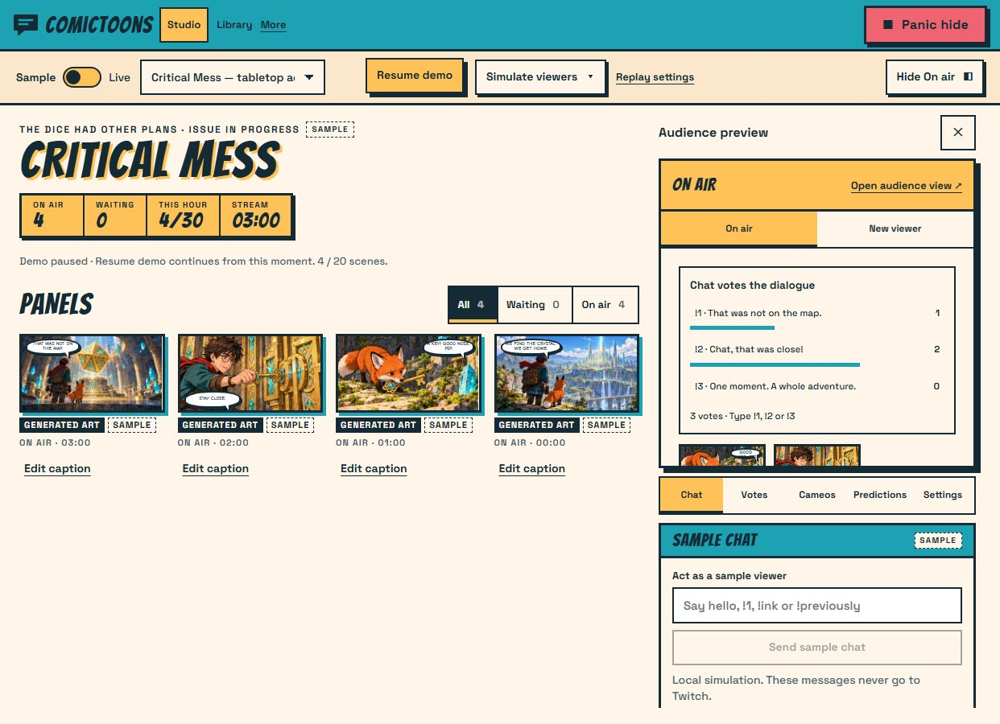
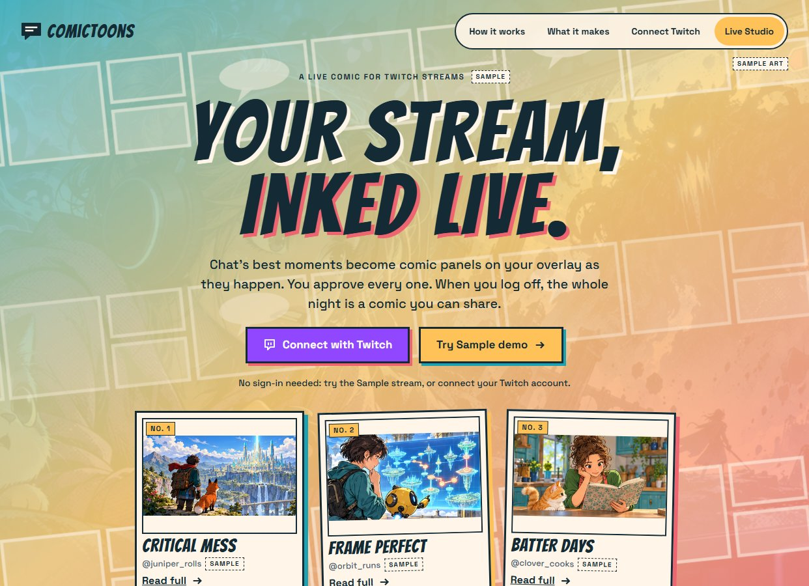
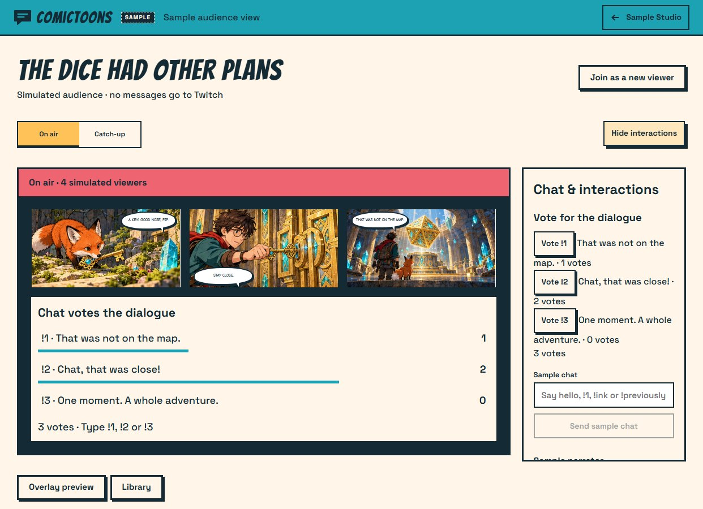
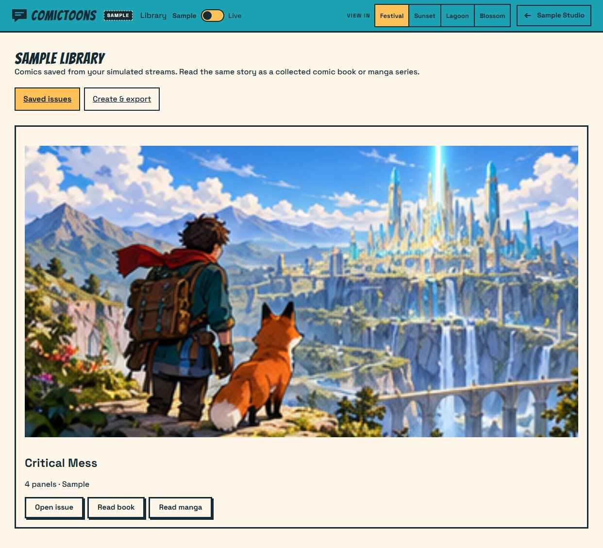
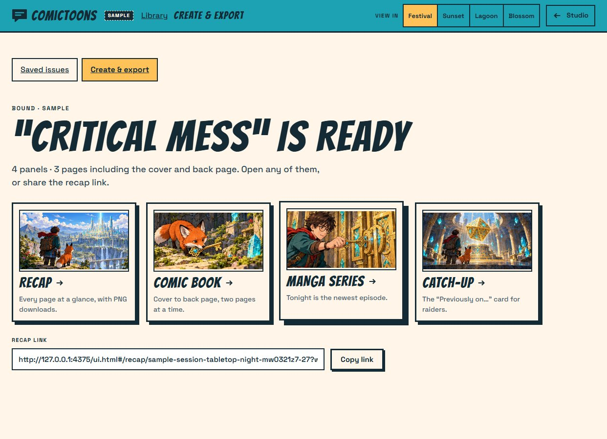
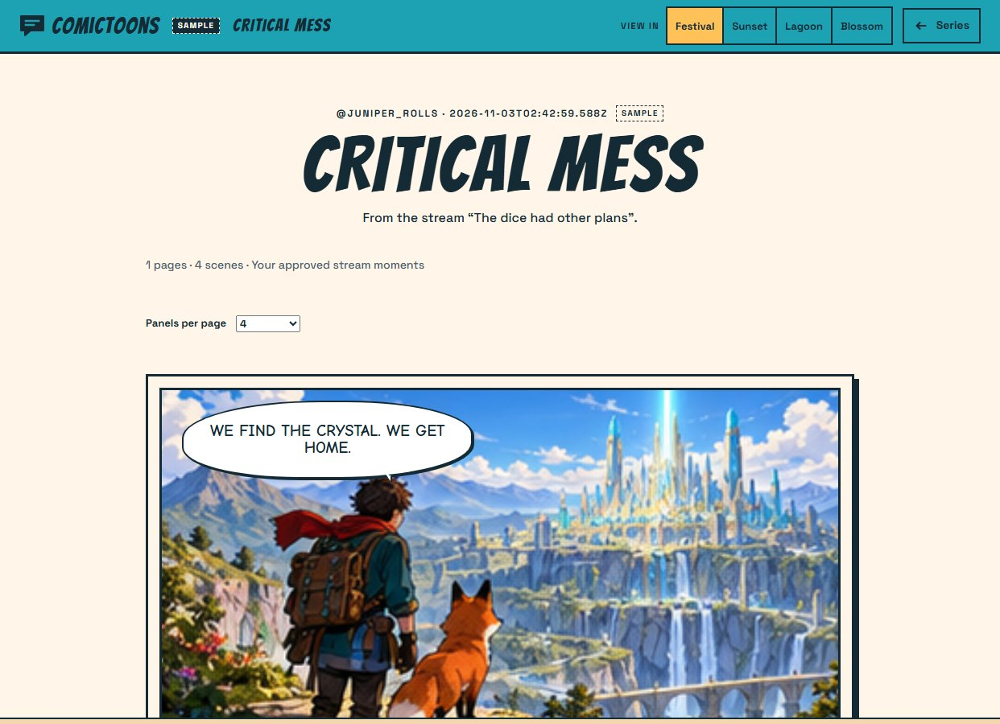
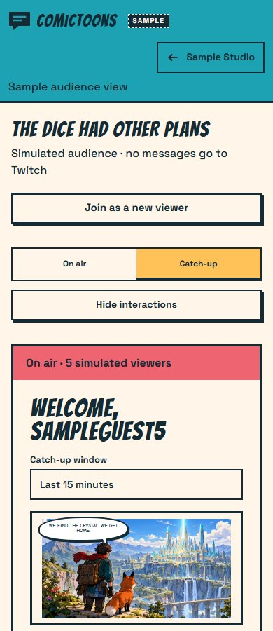

# ComicToons

Turn stream moments into a comic, review what goes on air, and give late arrivals a quick catch-up. Try the fictional Sample stream first, or connect Twitch and capture real video with matching chat.



**Updated: 3 November 2026.** This guide and its screenshots describe the local working tree. This documentation refresh has not been committed or pushed to GitHub.

[Install](#installation) · [Try Sample](#sample-demo) · [Connect Twitch](#configure-twitch-once) · [Live workflows](#live-workflows) · [OBS](#obs-overlay) · [Troubleshooting](#troubleshooting) · [Verification](#testing-and-current-status)

## What you can do

| Experience | What it does | What you need |
| --- | --- | --- |
| Sample Studio | Simulates chat, panel releases, arrivals, raid catch-up, dialogue votes, a cameo and a prediction; saves a Sample issue | Local app; no Twitch or image-provider credentials |
| Read public chat only | Reads a channel’s chat without video capture or panel creation | Twitch app configuration and your Twitch sign-in |
| Source-frame comic | Composes actual captured frames with attributed chat; your stream’s pages wait for review | Playing Twitch video and explicit capture; no image API key |
| Illustrated comic | Analyses captured frames, draws a page and checks the result | Supported provider credentials, model access and quota |
| Audience view | Shows released panels, On air / Catch-up switching and expandable interactions | Released Sample or Live content |
| Library | Groups saved issues with Create & export, collected books and manga readers | Released panels or a saved issue |
| OBS overlay | Presents released content without navigation in a Browser Source | Running app; OBS for broadcast use |

Comic book and manga are **two reading formats of the same story**. The landing page shows previews; **Read full comic book** and **Read full manga series** open the complete readers. Festival, Sunset, Lagoon and Blossom are the colour themes.

Sample and Live have separate chat, panels, catch-up, saved issues and output. Sample uses bundled art and local simulation; it does not prove that real Twitch capture or AI illustration passed review.

## Installation

### 1. Prerequisites

- Install [Node.js](https://nodejs.org/en/download) with npm. **Node 24 is the validated local setup**: 24.20.0 with npm 11.19.0. The package declares Node `>=20`; that is not a claim that every older release works with all dependencies.
- Use a recent browser. Install Git if you want to clone instead of downloading a ZIP.
- OBS is optional and needed only for broadcast-overlay use.

Check the terminal can find Node and npm:

```sh
node --version
npm --version
```

On Windows, reopen the terminal after installing Node. If PowerShell blocks `npm.ps1`, use `npm.cmd` and `npx.cmd` below; changing the machine’s execution policy is not required.

### 2. Get the source

Open the [project branch](https://github.com/TYK3/ComicToons/tree/codex/windows-demo-setup), choose **Code → Download ZIP**, and extract it. With Git:

```sh
git clone --branch codex/windows-demo-setup https://github.com/TYK3/ComicToons.git
cd ComicToons
```

If you already have this local working folder, use it directly. Run commands from the root containing `package.json`, not `apps/web`. A GitHub download includes that remote revision, not uncommitted local changes.

### 3. Dependencies and Chromium

```sh
npm ci
npx playwright install chromium
```

`npm ci` uses the lockfile and installs `sharp` for image composition. Playwright Chromium is used for capture and server-side image export. The downloads need internet access.

On Linux, if Playwright reports missing OS libraries:

```sh
npx playwright install --with-deps chromium
```

This may request permission to install system packages. Resolve browser-download or proxy errors before trying real capture.

### 4. Start the app

```sh
npm run dev
```

Keep the terminal open. Default addresses:

| Service | Address |
| --- | --- |
| Landing | [http://localhost:4173/](http://localhost:4173/) |
| Sample Studio | [http://localhost:4173/ui.html#/studio?workspace=sample](http://localhost:4173/ui.html#/studio?workspace=sample) |
| Live Studio | [http://localhost:4173/ui.html#/studio?workspace=live](http://localhost:4173/ui.html#/studio?workspace=live) |
| API state | [http://localhost:3001/api/state](http://localhost:3001/api/state) |
| Twitch callback | `http://localhost:3001/auth/twitch/callback` |

Open the **web port** to use the product. Vite proxies `/api`, `/auth`, `/art`, `/exports` and `/qa` to the API. Press **Ctrl+C** to stop the app.

`npm run demo` is an alternative launcher: it installs Chromium, starts both services and opens the landing page. It always opens a browser. Choose Sample in the app; the launcher does not erase existing configuration or disable a configured provider.

### Custom ports: the existing 3122 / 4122 setup

Set **both ports in the shell before starting**. The API loads `.env`, but Vite’s port/proxy configuration reads the process environment. Putting ports only in `.env` can leave the services using different configurations.

PowerShell:

```powershell
$env:COMICTOONS_API_PORT = '3122'
$env:COMICTOONS_WEB_PORT = '4122'
npm run dev
```

Bash / zsh:

```sh
COMICTOONS_API_PORT=3122 COMICTOONS_WEB_PORT=4122 npm run dev
```

Use [web port 4122](http://localhost:4122/ui.html#/studio?workspace=sample) and callback `http://localhost:3122/auth/twitch/callback`. Register that exact callback in Twitch and put the same URI in your private configuration. The API and web ports are different; they must form a matching pair.

PowerShell `$env:` values last for that terminal session. Open a new terminal for a clean environment, or remove a specific setting with `Remove-Item Env:COMICTOONS_API_PORT`. Startup fails if a requested port is already occupied.

## Sample demo

1. Open Sample Studio. The **Sample / Live** switch stays beside the stream selector while you scroll.
2. Click **Run demo**. Scenes release automatically and audience activity is simulated. Selecting another invented stream starts its guided demo.
3. **Pause demo / Resume demo** preserves your place. **Replay settings → Restart replay** starts manual review, where panels wait for Release, Reject or Edit caption. Manual replay speed is separate from the guided run.
4. Open **Simulate viewers** (**Simulator** on a phone). Try a viewer arrival, raid, vote, prediction or cameo; the sidebar shows the result on the same page.
5. Swap **On air / New viewer** in the preview. The lower **Chat / Votes / Cameos / Predictions / Settings** tabs show one controls group at a time. Close the drawer on narrow screens to use producer controls.
6. Open **Audience view** for **On air / Catch-up**, **Show chat & votes**, and **Join as a new viewer**. Sample votes/messages stay local.
7. A finished guided run binds an issue automatically. For a manual run, release panels, then use **More → End stream** or **Library → Create & export**.

Invented streams: Critical Mess (`tabletop-night`), Frame Perfect (`speedrun-fail`) and Batter Days (`irl-cooking`). The separate Jynxzi QA example uses manual replay and is labelled chat-inspired interpretation, not verified footage.

Sample time advances by one simulated minute per scene. Catch-up windows use story time, not the accelerated wall clock. Keep the driving Studio tab open. Sample state/issues are saved in this browser’s local storage; export a separate copy before clearing browser data. Restarting replay clears current output, not saved issues.

## Configure Twitch once

Sample needs no `.env`. For Live, copy the example **only if your private file does not already exist**.

PowerShell:

```powershell
if (-not (Test-Path .env)) { Copy-Item .env.example .env }
```

Bash / zsh:

```sh
if [ ! -f .env ]; then cp .env.example .env; fi
```

1. [Register your application with Twitch](https://dev.twitch.tv/docs/authentication/register-app/) using your own account. The official guide explains verification and 2FA requirements.
2. Add the exact callback for your port pair, including `http`, hostname, API port and `/auth/twitch/callback`, with no trailing slash.
3. Save the client ID and secret only in ignored `.env`. A source-frame starting configuration is:

```dotenv
COMICTOONS_TWITCH_CLIENT_ID=replace_with_your_client_id
COMICTOONS_TWITCH_CLIENT_SECRET=replace_with_your_client_secret
COMICTOONS_TWITCH_REDIRECT_URI=http://localhost:3001/auth/twitch/callback
COMICTOONS_IMAGE_PROVIDER=source
```

For ports 3122 / 4122, use `http://localhost:3122/auth/twitch/callback` instead and launch with both shell port variables.

4. Restart after environment edits. Open Live Studio, then **Connect with Twitch** or **Twitch account**. Complete sign-in/consent yourself.
5. Choose **Streamer** for your own channel. Start your broadcast separately in OBS or your streaming software; ComicToons does not start it.

Tokens stay in API-server memory; a restart requires sign-in again. For private server settings, precedence is shell values, then `.env`, then optional `.env.images`. Port variables belong in the shell as described above. [Detailed Twitch setup](docs/twitch-setup.md).

## Live workflows

### Read chat without capturing video

Open **Live setup → Read public chat only**, enter a username or Twitch URL, and press **Read chat**. The same picker is on Connect.

This reads chat without starting capture, creating panels, posting messages or changing your role. Other-channel reading does not grant broadcaster controls. **Use my channel** returns to your channel; **Stop reading** stops that input while keeping the workspace in Live.

### Create pages from video

1. For your channel, open **Live setup → Create pages from my live video**.
2. Expand **Page creation settings**. Choose **Use source-frame comic · no image API**, or explicitly configure an illustrated provider.
3. Choose 2, 5 or 10 minutes under **Capture duration**. Start with 2 minutes and a one-page limit for a small test.
4. Press **Capture my stream for 2 minutes** (the label follows your selected duration). Twitch video must be playing. At least four distinct captured frames are needed before page composition.
5. Inspect completed pages and source evidence. Streamer pages enter Studio review. **Release** shows a page, **Reject** excludes it, and **Edit caption** starts an eligible revision. `A`, `R`, `E` shortcuts can be disabled in Settings.
6. Stop capture when finished. Binding a comic and stopping an OBS broadcast are separate actions.

For another channel, open **Live setup → Capture another channel’s video**, then its capture-setup button. This explicitly enters **Viewer** setup. Choose settings/duration before pressing **Capture this stream for … minutes**. Viewer capture makes your viewing comic; it cannot approve, hide or manage that broadcaster’s stream. **Studio** returns to Streamer setup.

**Approved history is not a Twitch-wide comic library.** Viewer can show pages released by the connected broadcaster on this ComicToons server. Arbitrary channels may have no shared history. A load failure has a retry state, separate from “no released pages.”

Use **Live setup → Create pages from a VOD or clip** for the separate capped import workflow. See [clip/VOD details](docs/make-from-link.md).

### Votes, cameos and catch-up

Sample supplies its own local interactions. Real participation uses server flags and connected-channel capabilities:

```dotenv
COMICTOONS_PARTICIPATION_MOCK=0
COMICTOONS_FLAG_POLLS=1
COMICTOONS_FLAG_CATCHUP=1
COMICTOONS_FLAG_DIRECTOR=1
COMICTOONS_FLAG_NOINK=1
# Optional extras for eligible channels:
COMICTOONS_FLAG_TWITCH_POLLS=1
COMICTOONS_FLAG_INK_ME=1
COMICTOONS_FLAG_HYPE=1
```

Most flags default off; `NOINK` defaults on. Basic chat reading and source-frame composition need no Affiliate status. Native polls, predictions and channel-point rewards depend on Twitch eligibility/permissions; chat-vote fallback is available where supported.

For a real dialogue vote, keep two distinct ordinary chat lines fresh, choose an eligible waiting or released panel, open **Votes**, and start the vote. Viewers type the displayed `!1`, `!2` or `!3` in Twitch chat. Commands are not story dialogue. A revision succeeds when applied; “rendering” is unfinished and “image-failed” is a failure. Source-frame lettering composes locally; illustrated revisions can require provider calls.

Chat is commentary, not streamer speech. There is no audio transcription. `!noink` opts a viewer out of supported quotation/participation paths.

## Image providers and private configuration

Source-frame comics use actual frames and attributed lettering, without an external image API or AI illustration. Illustrated pages support these provider choices in **Page creation settings**:

| Choice | Private server defaults |
| --- | --- |
| Source frames | `COMICTOONS_IMAGE_PROVIDER=source` |
| OpenAI | `COMICTOONS_IMAGE_PROVIDER=openai`, `OPENAI_API_KEY`, optional `OPENAI_IMAGE_MODEL` |
| Gemini | `COMICTOONS_IMAGE_PROVIDER=gemini`, `GEMINI_API_KEY`, optional `GEMINI_IMAGE_MODEL` |
| Pollinations | `COMICTOONS_IMAGE_PROVIDER=pollinations`, `POLLINATIONS_API_KEY`, optional `POLLINATIONS_REFERENCE_MODEL` |
| Cloudflare | `COMICTOONS_IMAGE_PROVIDER=cloudflare`, `CLOUDFLARE_API_TOKEN`, matching `CLOUDFLARE_ACCOUNT_ID`; optional `CLOUDFLARE_REFERENCE_SLOT` and `CLOUDFLARE_REFERENCE_MODEL` |

Or enter your own key for one session. Cloudflare also needs its matching account ID. Choose from the current model dropdown; provider access/quota can change. [OpenAI walkthrough](docs/OPENAI_SETUP.md).

Session keys stay in server memory for up to one hour, not browser storage. A configured provider can run automatically during capture up to the page-attempt limit. Analysis, drawing, review and failed attempts can incur charges. **Check connection** does not guarantee credits or image quality. The attempt limit is not a dollar cap.

`COMICTOONS_ART_NETWORK` controls the legacy art path, not the scene-capture generator. To avoid image-provider calls, explicitly select Source-frame comic. Reference generation does not silently swap providers when the selected provider fails.

Keep real credentials in ignored `.env` / `.env.images` or the session form, never in source, screenshots, archives or `VITE_` variables. **Use app default / forget my key** removes the session key but can switch back to a configured server default; it does not necessarily disable generation.

## Audience view, Library and exports

- **Audience view:** open from Studio preview or More. Swap **On air / Catch-up**, choose the time window, and expand **Show chat & votes**. Sample controls simulate a viewer; Live commands are entered in Twitch chat. The Studio return remains available.
- **Library → Saved issues:** browse the active workspace’s comics and open an issue, book or manga series. Failed issue requests show recovery UI rather than a false empty library.
- **Library → Create & export:** choose title/formats and bind released panels. Recap/book/series links preserve the workspace; use their PNG download controls for portable images.
- **Local links:** a localhost recap URL does not publish anything. Others need access to the server; Sample issues additionally depend on that browser’s saved data. Export files for a portable copy.

## OBS overlay

Open the preview first; it has return navigation. For OBS, choose **Clean OBS output** and use `obs=1` with an explicit workspace:

```text
http://localhost:4173/ui.html#/overlay?workspace=live&obs=1
http://localhost:4173/ui.html#/overlay?workspace=sample&obs=1
```

Replace `4173` with `4122` for the existing web port. Keep ComicToons running and the driving Studio tab open for Sample playback. Add an OBS Browser Source, disable **Local file**, use your canvas resolution (for example 1920 × 1080), position it, and inspect the result. **Panic hide** blanks ComicToons output while panels can keep arriving.

Clean output intentionally has no navigation; operate through a separate Studio/audience tab. [Full OBS setup](docs/OBS_SETUP.md).

## Current screenshots

Captured from the local UI on 3 November 2026. Story content is Sample; the connection screenshot shows an unconfigured account. These are not live-Twitch or AI-quality proof. Addresses inside screenshots use isolated test ports; use the installation addresses above. [Screenshot inventory](docs/screenshots/README.md).

| Landing | Audience with expandable voting |
| --- | --- |
|  |  |

| Library | Create & export |
| --- | --- |
|  |  |

<details>
<summary>Reader, phone catch-up and Twitch setup</summary>






</details>

## Configuration

[.env.example](.env.example) contains placeholders, not shared credentials. Main settings:

| Setting | Effect / default |
| --- | --- |
| `COMICTOONS_API_PORT` / `COMICTOONS_WEB_PORT` | Shell settings; defaults 3001 / 4173 |
| `COMICTOONS_OPEN=0` | Suppresses browser opening for `npm run dev`; the demo explicitly opens one |
| `COMICTOONS_TWITCH_CLIENT_ID` / `_CLIENT_SECRET` / `_REDIRECT_URI` | Twitch credentials and exact callback |
| `TWITCH_CHANNEL` | Optional chat-channel fallback; explicit UI selection wins |
| `COMICTOONS_IMAGE_PROVIDER` | Explicit `source`, `openai`, `gemini`, `pollinations`, `cloudflare` |
| `COMICTOONS_FLAG_*` | Participation switches above; true values include `1`, `true`, `on`, `yes` |
| `COMICTOONS_PARTICIPATION_MOCK=0` | Disables mock participation for real verification |
| `COMICTOONS_PANEL_BUDGET_PER_HOUR` / `IMAGE_BUDGET_PER_HOUR` | Legacy/participation art budget; default 12. Scene capture also has a per-session attempt limit |
| `COMICTOONS_ART_NETWORK` | Opt-in legacy art path, not a master scene-generator switch |
| `COMICTOONS_DIRECTOR_KEY` | Optional secret required in `x-comictoons-director-key` for Studio-changing requests |
| `COMICTOONS_WEB_EXPOSE=1` | Opts dev web server into LAN binding; loopback by default |
| `COMICTOONS_SERVE_WEB=1` | API serves built web assets; build first. Also changes its listening interface |
| `COMICTOONS_TWITCH_ANON=1` | Separate operator opt-in to signed-out receive-only IRC; UI reading still asks for sign-in |

The shared environment helper accepts legacy `PANELCAST_*` aliases for settings using it. Twitch credentials also fall back to `TWITCH_CLIENT_ID`, `TWITCH_CLIENT_SECRET`, `TWITCH_REDIRECT_URI`. Prefer current names.

Director access protects local writes; Viewer sessions remain restricted from broadcaster APIs. Exposing a server is a separate hosting/security task, not something copying a recap link accomplishes.

## Troubleshooting

| Symptom | What to do |
| --- | --- |
| Node/npm missing | Install Node with npm, reopen the terminal and check versions. Try `npm.cmd` if PowerShell blocks the script |
| `npm ci` cannot find the project | Open the root containing `package.json` and `package-lock.json` |
| Chromium missing | Run `npx playwright install chromium`; on Linux install reported OS dependencies |
| Port occupied | Stop your duplicate app process or select another shell port pair; update Twitch’s API callback |
| Web cannot reach API | Keep both processes running; align Vite’s proxy and backend ports. Do not set ports only in `.env` |
| `redirect_mismatch` | Match registered/configured URI exactly: hostname, API port, path, no trailing slash. Restart after edits |
| Twitch disconnected after restart | Sign in again; tokens are in API memory |
| Read chat creates no pages | Correct for chat-only mode. Choose video capture and page settings |
| No frames | Channel must be live and video playing. Inspect ad/offline/player errors; Sample art is not substituted |
| Frames but no page | Wait for four distinct frames, choose Source frames or a provider, check attempts and held/failed reasons |
| Provider access/quota error | Check provider, account, model and quota. Explicitly select Source frames if appropriate; failed art is not success |
| Polls/rewards unavailable | Check flags, account capabilities and scopes; use displayed chat-vote fallback where available |
| Library/history unavailable | Retry and check the API; an error is different from no saved/released pages |
| Phone form is covered | Close the On air drawer; use Show On air to reopen it |
| Cannot return from overlay | Use the preview’s Studio return. Clean OBS output has no controls; keep a separate Studio tab |
| Recap link fails on another device | `localhost` points at that device. Export a file or separately configure an accessible server |

## Testing and current status

```sh
npm run typecheck
npm run lint
npm run test
npm run build
npm run e2e
npm run test:twitch -- --gate
npm run test:obs
npm run e2e:import-wire
npm run secrets
```

`npm run check` combines typecheck, lint and unit/contract tests. `npm run gate` also runs mock Twitch, builds, browser/OBS/import suites, secret scan, dependency audit and fresh-clone checks. The **maintainer owns the full gate**; focused checks are not a full-suite pass.

Browser tests use isolated loopback services. Default e2e ports are API 4301 / web 4273. For occupied test ports:

```powershell
$env:COMICTOONS_E2E_API_PORT = '4401'
$env:COMICTOONS_E2E_WEB_PORT = '4373'
npx playwright test -c tests/playwright.config.ts tests/ux-refinement.spec.ts
```

### Verified local evidence, 3 November 2026

- Latest UX work: **19 distinct focused browser checks** and **6 Node checks** passed across recorded runs; typecheck, ESLint, web build, generic secret scan and whitespace checks passed.
- Tested desktop/phone audience and public-chat states had no serious/critical axe findings. This is not full accessibility certification.
- One long guided replay regression awaits maintainer rerun after an accessible-selector fix. Its latest run reached the event sequence and saved issue before timing out on that selector. Direct desktop/phone selector and catch-up-window unit checks passed afterward. The long test is not counted as passing.
- Historical real evidence includes a ten-minute Twitch capture with 59 unique frames. This does not prove the latest full approval → vote → newcomer → export workflow passed live.
- Strict AI illustration fidelity has not passed the complete live proof; quota/provider failures remain documented. Source-frame output and AI illustration must be labelled accurately.

See [STATE.md](STATE.md) for delivery history/log paths and [the earlier QA sprint](docs/QA_SPRINT_2026-11-02.md) for real-source evidence. `artifacts/` contains ignored local evidence and may be absent from downloads. Older gate results do not certify the current working tree.

## Project structure and credits

| Path | Purpose |
| --- | --- |
| `apps/web/` | React/Vite landing, workspaces, audience/overlay, Library and readers |
| `apps/server/` | Fastify, Twitch auth/ingestion, capture, generation, participation, exports |
| `packages/core/` | Shared types, themes, layout/lettering rules and environment helpers |
| `fixtures/` / `apps/web/public/samples/` | Test and Sample assets |
| `tests/` / `scripts/` | Automated checks, launchers, harnesses and secret scans |
| `docs/` | Setup guides, QA references and current screenshots |
| `exports/` / `artifacts/` | Local output/evidence; review ignore rules before packaging |

The app uses React 19, Vite 6, Fastify 5, TypeScript and Playwright. Fonts and Sample art are served locally. See [dependency/license notes](docs/DEPENDENCIES.md), [art provenance](fixtures/art/generated/LICENSE-NOTE.md), [lettering maps](docs/LETTERING_MAPS.md) and [BACKLOG.md](BACKLOG.md).

## How Codex was used and submission record

The owner supplied product direction, visual requirements, approval rules and testing authorization. Codex implemented/debugged UI, Twitch integration, capture, provider adapters, lettering, review, participation, export, tests and documentation. Live images come through the app’s selected provider; a separate image-generation tool was not used to manufacture live-proof artwork. Incomplete/failed checks remain recorded.

- Recorded build/QA session: `01a1989f-bf57-71f0-a88f-c10dad4473ec`.
- Earlier build session: `01a18f6b-e271-7c62-96c6-d743ad8eda57`.
- Demo video: not yet linked in this README.
- No public deployment is claimed. This documentation/screenshot refresh is local only.

For submission, provide reviewed source/assets, runnable instructions, an accurate demo and relevant build-session IDs. Check the organizer’s current requirements separately. Never package private environment files, stream/session keys, captures or chat logs unintentionally. A ZIP made from a working folder can contain ignored files; a GitHub ZIP contains only that remote revision.
