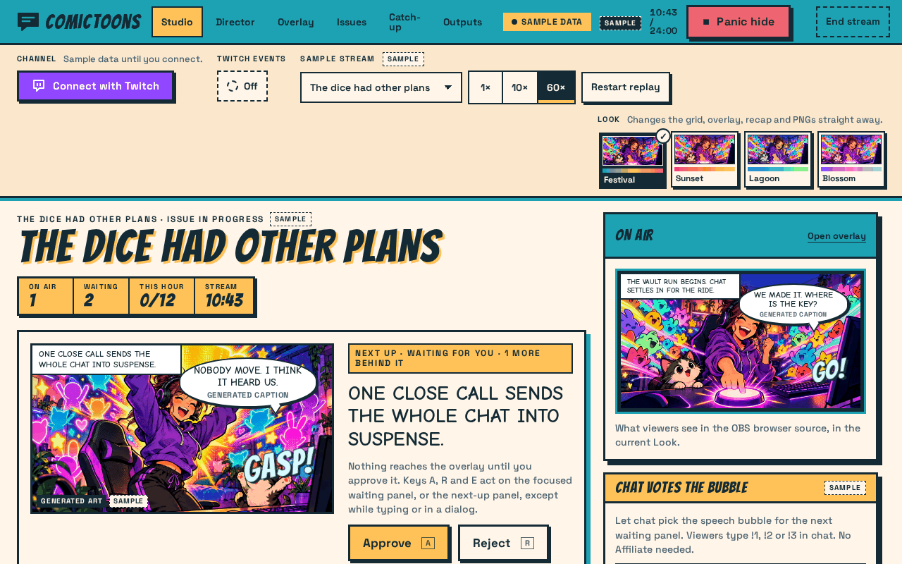
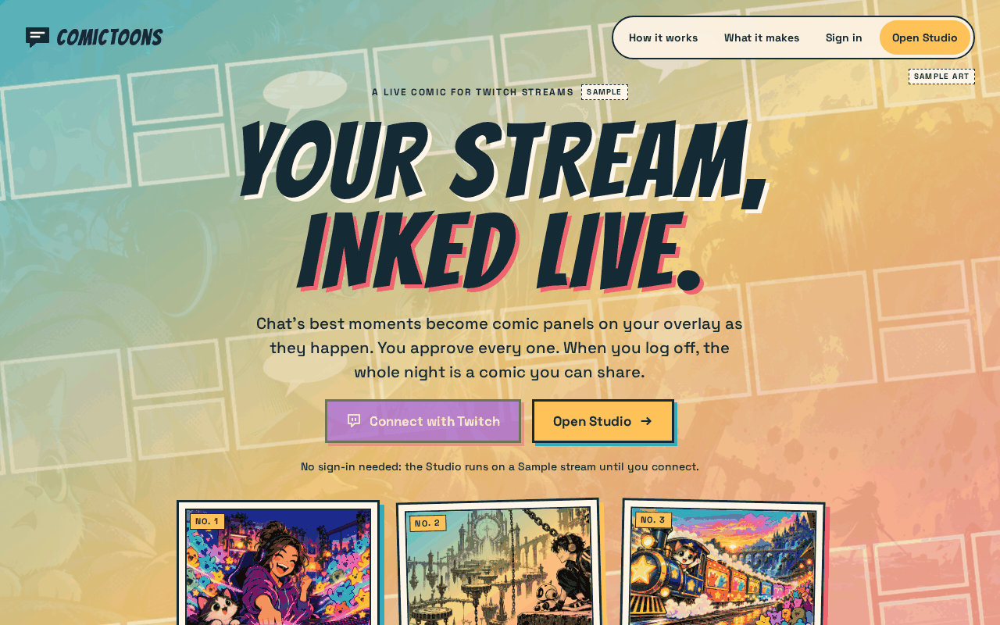
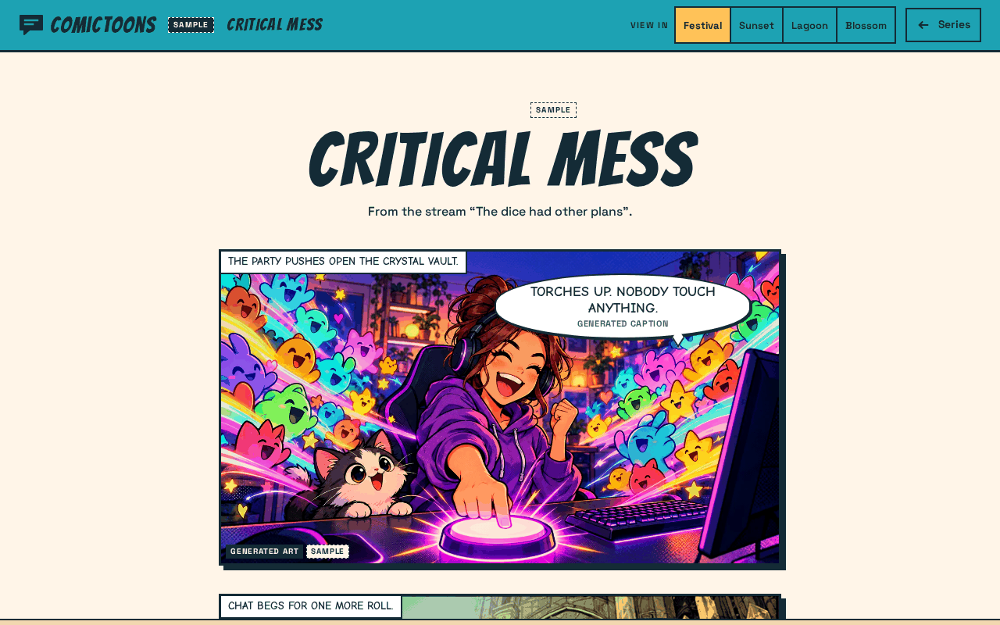
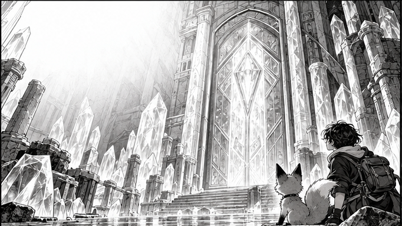
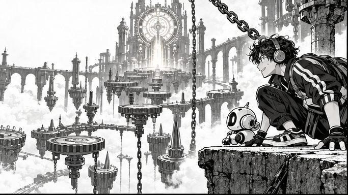
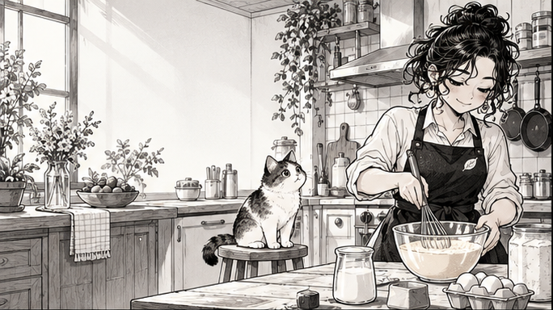
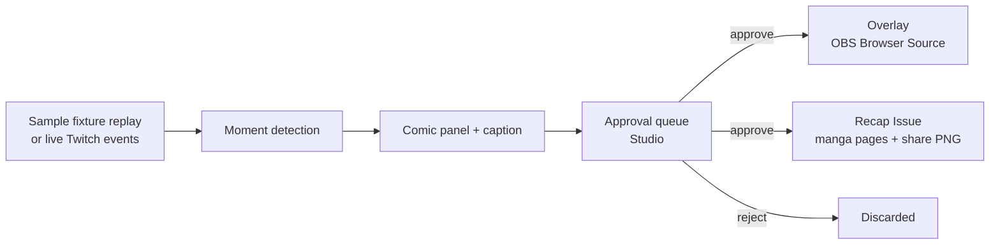

<p align="center">
  
</p>

<p align="center"><b>Your stream's best moments, inked as comic panels while you are still live.</b></p>

<p align="center">
  <a href="#run-it-yourself"></a>
</p>

<p align="center">
  
  
  
  
  
  
  
  
</p>

<table align="center">
<tr>
<td align="center" width="33%">✅<br><b>Studio approval queue</b><br><sub>Every strip waits for the streamer: <code>A</code> approve, <code>E</code> edit, <code>R</code> reject.</sub></td>
<td align="center" width="33%">📺<br><b>Live OBS overlay</b><br><sub>A transparent browser source that shows only approved panels and chat votes.</sub></td>
<td align="center" width="33%">📚<br><b>Recap Issue</b><br><sub>End the stream and the approved panels are bound into manga pages, a PNG share card and an HTML export.</sub></td>
</tr>
</table>

# 💥 ComicToons: _every stream has a story_

> **ComicToons turns the last few minutes of a stream into comic panels, shows them live in an OBS browser-source overlay, and collects the approved panels into a shareable Recap Issue.** Chat, raids, cheers, polls and clips are grouped into panel-worthy moments and drawn from a bundled, project-owned art library. Captions, dialogue and sound effects are HTML lettering laid over the art, never burned into it. Nothing reaches the audience until the streamer approves it, and the whole product runs from a fresh clone with no keys at all.

<details open>
<summary><b>📑 Contents</b> (click to collapse)</summary>

- [🎬 Demo video](#demo-video)
- [📖 Overview](#overview)
- [🎯 The problem](#the-problem)
- [🧭 A 2-minute tour](#a-2-minute-tour)
- [🖼️ What it looks like](#what-it-looks-like)
- [✨ Features](#features)
- [⚙️ How it works](#how-it-works)
- [🏗️ Architecture](#architecture)
- [🗺️ Repo map](#repo-map)
- [🛠️ Run it yourself](#run-it-yourself)
- [🔧 Configuration](#configuration)
- [🧪 Testing and quality gate](#testing)
- [📊 Measured results](#measured-results)
- [🛡️ Safety and trust](#safety)
- [🚧 Known limits](#known-limits)
- [🔭 Future work](#future-work)
- [🙏 Credits and licences](#credits)
- [❓ Questions and answers](#questions-and-answers)
- [📝 Submission](#submission)

</details>

---

<a id="demo-video"></a>

## 🎬 Demo video

The demo video link is still to come (see [Submission](#submission)). Until then, the [2-minute tour](#a-2-minute-tour) walks through the same flow on your own machine, with no account and no keys.

---

<a id="overview"></a>

## 📖 Overview

### 💭 What happens to the best moment of a stream?

It scrolls away. The clutch comeback, the raid that arrives at exactly the wrong time and the kitchen fire that chat will not stop talking about all live in a chat log nobody re-reads and a VOD most viewers never open.

### ✋ Turn the moment into a page, and keep the streamer in charge

ComicToons listens to the same events a streamer already has (chat, raids, cheers, polls, predictions, hype trains, channel-point redemptions and clips), decides which ones make a moment, and drafts a comic strip for each. The streamer approves, edits or rejects every strip from the Studio; only approved panels go on air and into the Recap Issue.

### 👥 Who it is for

- **Streamers** who want a recap their community can share, without editing anything after the stream.
- **Viewers** who missed the stream and want the story in a minute, not a three-hour VOD.
- **Moderators**, who can approve or reject the oldest waiting panel from chat with `!ink yes` / `!ink no` when director mode is on (`COMICTOONS_FLAG_DIRECTOR=1`).

---

<a id="the-problem"></a>

## 🎯 The problem

<p align="center"><b>How might we turn the chaos of live chat into something worth catching up on, without putting unreviewed chat on screen?</b></p>

### Why the options that exist today fall short

| Today's option | ✅ Good at | ❌ Falls short |
|---|---|---|
| ✂️ Clips | Instant, native to Twitch | One moment at a time, with no story between them |
| 🎞️ VOD highlights | Complete | Hours of footage; someone has to edit them after the stream |
| 🖌️ Fan art | Loved by communities | Slow, and only for the moments an artist happens to catch |
| 🤖 Unfiltered chat overlays | Live | Put whatever chat says straight on screen |
| 💥 **ComicToons** | **Moments drafted live, approved by the streamer, bound into a shareable issue** | Bundled art in the default build; live generated art is opt-in (see [Known limits](#known-limits)) |

---

<a id="a-2-minute-tour"></a>

## 🧭 A 2-minute tour

Start the demo first (`npm ci`, then `npm run demo`; see [Run it yourself](#run-it-yourself)). It opens `http://localhost:4173/` by default.

| # | Do this | What you'll see |
|---|---|---|
| **1** | On `/`, choose **Open Studio** (or open `/#/studio`) | The Studio, with a sample stream ready. The classic app remains at `/classic`. |
| **2** | Pick a stream from the **Sample stream** list and a replay speed (1×, 10× or 60×) | The replay starts as soon as a stream is picked; **Restart replay** starts it again |
| **3** | Approve or reject strips as they arrive (`A` / `E` / `R`, or the on-screen controls) | Approved strips move on air; rejected ones are discarded |
| **4** | Choose **Open overlay**, or open `http://localhost:4173/ui.html#/overlay` in another window (or add it to OBS as a 1920×1080 Browser Source) | Only approved panels, live |
| **5** | Choose **End stream** in the top bar, then **End stream and bind** | The Recap Issue. The Output page links the Recap (with PNG downloads), Comic book, Manga series and Catch-up views |
| **6** | Open `exports/<recap id>/` in the repo | The exported files, including the `share.png` share card |

No Twitch or image-provider credentials are needed for any of these steps: the demo runs entirely on bundled art and invented sample chat.

---

<a id="what-it-looks-like"></a>

## 🖼️ What it looks like

Captured at 1280×800 from a local build running the keyless Sample stream (no Twitch sign-in, no hosted image generation). The sample channel handle is hidden in the reader shot.

<p align="center"><br><sub><b>Landing.</b> The entry point: open the Studio straight away, or connect Twitch. Everything shown is sample data.</sub></p>

<table>
<tr>
<td width="50%"><br><sub><b>Studio.</b> The next strip waits for <b>Approve</b> (<code>A</code>) or <b>Reject</b> (<code>R</code>); the On air card shows what the overlay shows. Look swatches re-theme everything.</sub></td>
<td width="50%"><br><sub><b>Reader.</b> The sample issue read as manga, with the caption and speech bubble lettered as HTML over the art, and a theme switcher. The sample channel handle above the title is hidden.</sub></td>
</tr>
</table>

### Sample-library art

Story panels from the three bundled sample streams. All three streams, their chat and their characters are invented for this project.

<table>
<tr>
<td width="33%"><br><sub><b>Tabletop Night</b> (<code>tabletop-night</code>). A tabletop campaign night.</sub></td>
<td width="33%"><br><sub><b>Speedrun Fail</b> (<code>speedrun-fail</code>). A run that does not go to plan.</sub></td>
<td width="33%"><br><sub><b>IRL Cooking</b> (<code>irl-cooking</code>). A cooking stream with a watchful cat.</sub></td>
</tr>
</table>

<p align="center"><sub>Panels are shown here without lettering. In the app, captions, dialogue and SFX are rendered as HTML text in the panel's safe zones (<a href="docs/LETTERING_MAPS.md">docs/LETTERING_MAPS.md</a>).</sub></p>

---

<a id="features"></a>

## ✨ Features

- 🔑 **Keyless sample demo.** Three invented sample streams (`tabletop-night`, `speedrun-fail`, `irl-cooking`) replay at 1×, 10× or 60× through the same pipeline as a live stream, so the whole product can be seen with no credentials and no network calls.
- ✅ **Studio with an approval queue.** The streamer reviews each incoming strip before it goes on air (`A` approve, `E` edit caption, `R` reject), or switches to automatic publishing.
- 📺 **OBS overlay.** A transparent overlay page (`ui.html#/overlay`) shows approved panels and chat votes live, for use as an OBS Browser Source ([docs/OBS_SETUP.md](docs/OBS_SETUP.md)).
- 📚 **Recap Issue.** Ending the stream (or saving early) lays the approved panels out as manga-style pages, with a downloadable PNG share card and a standalone HTML export.
- 🎨 **Two art styles.** Risograph and noir panels are drawn from a bundled, project-owned art library; lettering is never burned into the image. The noir style is picked in the classic app at `/classic` (its "Midnight noir" art direction).
- 🌈 **Four manga colour themes.** Festival colour (the default), Sunset glow, Lagoon and Blossom re-theme the same approved art and lettering ([docs/manga-colour-themes.md](docs/manga-colour-themes.md)).
- 🟣 **Twitch sign-in and EventSub.** The server implements the Twitch OAuth authorisation-code flow and an EventSub WebSocket bridge (chat, raids, cheers, polls, predictions, hype trains, channel-point redemptions, stream online/offline), with a read-only Twitch IRC adapter as a chat fallback. Connect at `/ui.html#/connect`.
- 🔗 **Make a comic from a Twitch link.** Paste a clip, VOD or channel link into the Studio's "Make a comic from a link" card. A VOD gives up to 6 clips from its first 10 minutes (longer VODs are clamped, not refused), one panel each. A single clip gives 1 to 4 panels, and an optional chat log is split across them. The result can be added as a chapter to that channel's manga series. Needs Twitch app credentials; see [docs/make-from-link.md](docs/make-from-link.md). _This card arrives with the make-from-link UI, which lands after the import stack; until then the server's `POST /api/import` route is in place but the card is not shown in the Studio._
- 🎬 **Clip watch.** While a signed-in Twitch session is live, the server checks the signed-in channel for new clips every 30 seconds. Three or more clips within 120 seconds open one clip moment, framed from the most-viewed clip (the frame is inked only with `COMICTOONS_ART_NETWORK=1`). The Studio toolbar shows "Clips: N" for the session, and polling stops when the stream goes offline.
- 🗳️ **Chat votes.** With `COMICTOONS_FLAG_POLLS=1`, the Director's "Start a vote" button opens a 45-second chat vote on the oldest waiting panel, with up to 3 choices taken from recent chat. Viewers vote with `!1` to `!3`, one vote each (a later vote replaces an earlier one), and the winning line is written into that panel's caption. Votes are commands, so they never become panel dialogue.
- 🔐 **Director-key access control.** Studio-changing requests are restricted to the local machine, or to a client that sends a configured director key.

---

<a id="how-it-works"></a>

## ⚙️ How it works



1. **Ingest.** `apps/server` takes events from a sample fixture replay, or from live Twitch through EventSub and the IRC fallback. `POST /api/ingest` accepts events from an allowed client.
2. **Group into moments.** Events are scored and grouped into panel-worthy moments (for example a raid, a hype train or a cluster of clips).
3. **Draw and letter.** Each moment is matched against the bundled art library and given a caption and dialogue, which are lettered as HTML text in the panel's safe zones.
4. **Approve.** With approval on (the default), strips wait in the Studio queue. Only approved panels reach the overlay and the recap.
5. **Bind.** `POST /api/end` lays the approved panels out as manga pages and writes the HTML, PNG pages and share card to `exports/<recap id>/`, using Playwright screenshots.

`apps/web` polls the server and streams updates through Server-Sent Events: the Studio shows the queue, the Overlay shows only approved panels, and the Recap view renders the saved issue.

---

<a id="architecture"></a>

## 🏗️ Architecture

| Stage | Module | What happens |
|---|---|---|
| **Replay** | `fixtures/*.json`, `apps/server/src/studio.ts` | Sample streams replay at 1×, 10× or 60× through the live pipeline |
| **Live ingest** | `apps/server/src/eventsub/`, `apps/server/src/ingest/irc.ts` | EventSub WebSocket bridge; read-only IRC chat fallback (anonymous only with `COMICTOONS_TWITCH_ANON=1`) |
| **Clips** | `apps/server/src/ingest/clips.ts` | 30-second clip polling and clip-cluster moments |
| **Import** | `apps/server/src/import/` | `POST /api/import`: clip, VOD and channel links into panels, with caps on VOD length and panel count |
| **Participation** | `apps/server/src/participation/` | Chat votes, predictions, channel-point rewards, `!ink` / `!noink`, director controls; all behind flags |
| **Access** | `apps/server/src/director-access.ts` | Local-only writes, or the `x-comictoons-director-key` header |
| **Export** | `apps/server/src/export.ts`, `apps/server/src/recaps.ts` | Recap HTML, page PNGs and the share card |
| **Shared model** | `packages/core/` | Types, the moment and story model, manga page layout, colour themes, lettering maps |
| **Web** | `apps/web/` | Landing page, Studio, transparent Overlay, Connect, Output, Recap and manga reader |

See [docs/live-ingest.md](docs/live-ingest.md) for the live-ingest design and [docs/twitch-setup.md](docs/twitch-setup.md) for sign-in and the director-key access contract.

---

<a id="repo-map"></a>

## 🗺️ Repo map

| Path | What it is |
|---|---|
| `apps/server/` | Fastify API: ingest, approval queue, participation, Twitch OAuth and EventSub, import, recap export |
| `apps/web/` | Vite + React app: landing page, Studio, Overlay, Recap and manga reader |
| `packages/core/` | Shared types, moment and story model, manga layout, themes, lettering maps |
| `fixtures/` | The three sample stream event logs and the bundled art library |
| `tests/` | Unit and contract tests (Node's test runner) and Playwright browser tests, including the OBS suite |
| `scripts/` | Demo launcher, test runners, mock Twitch harness, secret scan, fresh-clone check |
| `docs/` | Setup, live-ingest, lettering-safety and dependency reference docs |
| `exports/` | Generated recap exports (not tracked) |

---

<a id="run-it-yourself"></a>

## 🛠️ Run it yourself

<details open>
<summary><b>⚡ Quick start (keyless demo)</b></summary>

Needs Node.js 20 or later and npm. From a fresh clone, install the exact locked dependencies with `npm ci`:

```sh
git clone https://github.com/TYK3/ComicToons && cd ComicToons
npm ci
npm run demo
```

`npm run demo` installs the Playwright Chromium browser on first run (this needs network access), then starts the server and web app and opens its configured web address (`http://localhost:4173/` by default) in a browser. It always opens one, even when `COMICTOONS_OPEN=0` is set. It honours `COMICTOONS_API_PORT` and `COMICTOONS_WEB_PORT` (defaults 3001 and 4173); set them in the shell, not in `.env`:

```sh
# bash, zsh (macOS, Linux, Git Bash)
COMICTOONS_API_PORT=3122 COMICTOONS_WEB_PORT=4122 npm run demo
```

```powershell
# PowerShell (Windows)
$env:COMICTOONS_API_PORT='3122'; $env:COMICTOONS_WEB_PORT='4122'; npm run demo
```

Feature flags (see [Configuration](#configuration)) are set the same way, for example:

```sh
# bash, zsh (macOS, Linux, Git Bash)
COMICTOONS_FLAG_POLLS=1 npm run demo
```

```powershell
# PowerShell (Windows)
$env:COMICTOONS_FLAG_POLLS='1'; npm run demo
```

In bash the variables apply to that one command only. In PowerShell `$env:` settings stay for the rest of that PowerShell window; clear one with `Remove-Item Env:COMICTOONS_FLAG_POLLS`, or open a new window.

On Node 20, npm prints `EBADENGINE` warnings for `@axe-core/playwright` (test-only) and `cookie` (pulled in by Fastify's request injection, which the server also uses at runtime), which declare Node 22. They are expected and harmless.

</details>

<details>
<summary><b>🧑‍💻 Day-to-day development</b></summary>

```sh
npm run dev
```

This starts `apps/server` on `http://127.0.0.1:3001` and `apps/web` (Vite) on `http://127.0.0.1:4173` by default, with the web dev server proxying `/auth`, `/api`, `/exports` and `/art` to the server. Unlike `npm run demo`, it skips the Playwright browser install.

</details>

<details>
<summary><b>🟣 Live Twitch</b></summary>

Copy `.env.example` to `.env`, set `COMICTOONS_TWITCH_CLIENT_ID`, `COMICTOONS_TWITCH_CLIENT_SECRET` and (if not the default) `COMICTOONS_TWITCH_REDIRECT_URI`, then sign in at `/ui.html#/connect`. The full sign-in and access contract is in [docs/twitch-setup.md](docs/twitch-setup.md).

</details>

---

<a id="configuration"></a>

## 🔧 Configuration

Copy `.env.example` to `.env` (git-ignored) to configure optional features. With no `.env` file, everything needed for the sample demo works with zero keys.

Only the API server loads `.env`, when it starts. The Vite dev server and `npm run demo` read the shell environment only, so set `COMICTOONS_API_PORT`, `COMICTOONS_WEB_PORT`, `COMICTOONS_OPEN` and `COMICTOONS_WEB_EXPOSE` there. Keep the port variables out of `.env`: a port set there moves only the API, while the web app stays on its default port and keeps proxying to API port 3001.

Every `COMICTOONS_*` variable below also accepts a legacy `PANELCAST_*` prefix in its place (`packages/core/src/env.mjs`). Twitch credentials also fall back to `TWITCH_CLIENT_ID`, `TWITCH_CLIENT_SECRET` and `TWITCH_REDIRECT_URI`.

<details>
<summary><b>All variables</b></summary>

| Variable | Purpose |
|---|---|
| `COMICTOONS_API_PORT` | Port for the Fastify API (default 3001) |
| `COMICTOONS_WEB_PORT` | Port for the Vite web app (default 4173) |
| `COMICTOONS_OPEN` | Set to `0` to stop `npm run dev` opening a browser on start (`npm run demo` always opens one) |
| `COMICTOONS_PANEL_BUDGET_PER_HOUR` | Cap on generated panel art per rolling hour; falls back to `IMAGE_BUDGET_PER_HOUR`, then 12 |
| `COMICTOONS_FLAG_POLLS` / `_TWITCH_POLLS` / `_INK_ME` / `_CATCHUP` / `_HYPE` / `_DIRECTOR` / `_NOINK` / `_BOT_REPLIES` | Participation feature flags; all default off except `_NOINK`. Accepted true values: `1`, `true`, `on`, `yes` |
| `COMICTOONS_TWITCH_CLIENT_ID` | Twitch application client ID, for OAuth sign-in |
| `COMICTOONS_TWITCH_CLIENT_SECRET` | Twitch application client secret |
| `COMICTOONS_TWITCH_REDIRECT_URI` | OAuth redirect URI registered in the Twitch developer console (defaults to `http://localhost:3001/auth/twitch/callback`) |
| `COMICTOONS_TWITCH_ANON` | Set to `1` to allow signed-out, read-only anonymous IRC; never sends chat replies |
| `TWITCH_CHANNEL` | Optional public chat channel; defaults to the signed-in login |
| `IMAGE_BUDGET_PER_HOUR` | Cap on generated panel art per rolling hour (default 12) |
| `COMICTOONS_ART_NETWORK` | Set to `1` only for a short, named proof run against a hosted image provider; leave unset for builds, gates and QA |
| `CLOUDFLARE_API_TOKEN[_2/_3]` / `CLOUDFLARE_ACCOUNT_ID[_2/_3]` | Hosted image provider credentials (up to three key slots, tried in order, for quota fallback) |
| `POLLINATIONS_API_KEY[_2/_3]` | Alternate hosted image provider credentials (up to three key slots) |
| `COMICTOONS_DIRECTOR_KEY` | When set, every studio-changing request needs this secret in the `x-comictoons-director-key` header, including localhost; unset means only the local machine can write |
| `COMICTOONS_WEB_EXPOSE` | Set to `1` to bind the web dev server to all interfaces instead of only `127.0.0.1`; configure a director key first |

</details>

---

<a id="testing"></a>

## 🧪 Testing and quality gate

```sh
npm run check                  # typecheck, lint, unit and contract tests
npm run e2e                    # Playwright browser tests
npm run test:twitch -- --gate  # local fake Twitch suite on the gate ports
npm run test:obs               # isolated OBS browser-source suite, after e2e
npm run gate                   # everything below, in order
```

`npm run gate` runs, in order:

| # | Step | Script |
|---|---|---|
| 1 | Typecheck | `tsc --noEmit` |
| 2 | Lint | `eslint .` |
| 3 | Unit and contract tests | `node scripts/run-tests.mjs` |
| 4 | Mock Twitch suite | `scripts/twitch-mock/run-tests.mjs --gate` |
| 5 | Build | every workspace |
| 6 | Browser tests | `tests/playwright.config.ts` |
| 7 | OBS browser-source suite | `tests/obs/playwright.config.ts` |
| 8 | Make-from-a-link browser tests against a fake Twitch (`npm run e2e:import-wire`) | `tests/import-wire/playwright.config.ts` |
| 9 | Secret scan | `scripts/secret-scan.mjs` |
| 10 | Dependency audit | `npm audit --audit-level=high` |
| 11 | Fresh-clone smoke test | `scripts/fresh-clone.mjs` |

Install the Playwright browser once with `npx playwright install chromium` if `npm run e2e` or `npm run gate` reports it missing. The fresh-clone step runs a clean-directory offline install and build; it does not re-run the full browser suite in that directory.

`npm run test:twitch -- --gate` runs the mock Twitch harness on loopback ports 3120 (app) and 4120 (fake) by default. Set `COMICTOONS_TWITCH_TEST_APP_PORT` and `COMICTOONS_TWITCH_TEST_FAKE_PORT` to choose other ports. The harness refuses inherited `TWITCH_CLIENT_ID`, `TWITCH_CLIENT_SECRET`, `COMICTOONS_TWITCH_CLIENT_ID` or `COMICTOONS_TWITCH_CLIENT_SECRET`; leave those unset for it. The gate keeps unfinished checklist and unavailable CLI cases explicitly skipped.

---

<a id="measured-results"></a>

## 📊 Measured results

These are the results of the project's full quality gate (`npm run gate`) as recorded in the integration reports; nothing here is estimated. The table is an earlier full gate during the freeze, before the history rewrite (the commit it ran on is not in the pushed history, so no hash is given). That gate had 10 steps; the import-wire step was added to the gate later.

| Check | Result | Measured on |
|---|---|---|
| Type check (`tsc`) and lint | ok | earlier full gate during the freeze, 1 Nov 2026, 06:43–06:58 GMT |
| Unit tests | 728/728 | earlier full gate during the freeze, 1 Nov 2026, 06:43–06:58 GMT |
| Twitch mock harness (`npm run test:twitch`) | 38 pass / 0 fail | earlier full gate during the freeze, 1 Nov 2026, 06:43–06:58 GMT |
| Production build | ok | earlier full gate during the freeze, 1 Nov 2026, 06:43–06:58 GMT |
| Browser end-to-end tests (`npm run e2e`) | 130 passed | earlier full gate during the freeze, 1 Nov 2026, 06:43–06:58 GMT |
| OBS overlay tests (`npm run test:obs`) | 11 passed | earlier full gate during the freeze, 1 Nov 2026, 06:43–06:58 GMT |
| Secret scan (`npm run secrets`) | "Secret scan passed" | earlier full gate during the freeze, 1 Nov 2026, 06:43–06:58 GMT |
| Dependency audit (`npm audit`) | 11 moderate, 0 high | earlier full gate during the freeze, 1 Nov 2026, 06:43–06:58 GMT |
| Fresh-clone install and build (`npm run fresh-clone`) | passed | earlier full gate during the freeze, 1 Nov 2026, 06:43–06:58 GMT |
| Whole gate | exit 0, no reruns | earlier full gate during the freeze, 1 Nov 2026, 06:43–06:58 GMT |
| Unit tests (pre-commit check, not a full gate) | 733/733 | a later freeze commit, 1 Nov 2026 |

**Final main:** a full gate on `8cb54bb`, the final main before this docs commit, run offline on 1 Nov 2026, exited 0: typecheck and lint ok, unit 768/768, Twitch mock harness 39 pass / 0 fail / 13 skipped, build ok, e2e 130 passed, OBS 11 passed, import-wire 8 passed, secret scan passed, fresh clone passed. The dependency audit was skipped because the run was offline; the last audit, on the final tree before the history rewrite, showed 11 moderate and 0 high.

### ⏳ Not yet measured

- **GAP:** a dependency audit on the exact final main (the gate above ran offline).
- **GAP:** the number of skipped live-Twitch checklist cases in the earlier gate in the table (the report gives pass and fail counts only).
- **GAP:** a run on a real Windows machine (the PowerShell steps are checked by tests, not on Windows).
- **GAP:** timings, load and real-stream measurements; the demo video is still to be recorded.

---

<a id="safety"></a>

## 🛡️ Safety and trust

- ✅ **Approval is on by default.** Panels reach the overlay and recap only once approved.
- 🧼 **Chat is untrusted input.** It is sanitised before use, and React renders captions and dialogue as text, never as HTML.
- 🙅 **`!noink` always wins.** It is honoured whatever the flags say and takes precedence over `!ink` opt-in; opting out drops the viewer from caption votes, their recent chat lines and pending channel-point rewards.
- 🔐 **No credentials in the repo.** Credentials are never read from fixtures or committed; `.env` is git-ignored, and the gate runs a secret scan.
- 🏠 **Local by default.** Studio-changing requests need a local connection or a configured director key, and the web dev server binds to `127.0.0.1` unless `COMICTOONS_WEB_EXPOSE=1`.
- 🖋️ **No in-image lettering.** Dialogue, selected chat and SFX render as editable lettering, with overflow paginated to keep faces clear, per the safe zones in [docs/LETTERING_MAPS.md](docs/LETTERING_MAPS.md).
- 🌐 **No network art by default.** Hosted image-provider calls happen only with `COMICTOONS_ART_NETWORK=1`, never in the default demo, build or tests.

---

<a id="known-limits"></a>

## 🚧 Known limits

- 🔁 **Tokens live in memory.** Twitch Connect is at `/ui.html#/connect` (also `/#/connect` from the default UI). Tokens stay in server memory only, so the streamer signs in again after an API restart.
- 🚩 **Participation is off by default.** Chat votes, channel-point rewards, prediction and hype-train display, the director phone page and catch-up triggers are implemented but sit behind environment flags. They use the signed-in Helix client, with an in-memory mock while signed out.
- 🎨 **Bundled art by default.** Hosted image generation is opt-in (`COMICTOONS_ART_NETWORK=1`) and is not exercised by the default demo, build or test commands.
- ⏱️ **Imports are capped.** A VOD link reads only its first 10 minutes and gives at most 6 panels; a single clip gives at most 4.
- 🧪 **Hackathon stage.** See [BACKLOG.md](BACKLOG.md) for planned work and [STATE.md](STATE.md) for delivery history.

---

<a id="future-work"></a>

## 🔭 Future work

- 🎬 **Raid callback strip.** A "PREVIOUSLY ON…" panel for raids and late joiners.
- 🎨 **More art direction.** A Style Bible editor and additional bundled art styles beyond today's Risograph and noir.
- ♿ **Richer accessibility and motion.** Optional motion and sound, reduced-motion support, alt text and a transcript.
- 🧪 **Chaos testing.** Reconnects, rate limits, timeouts, high chat volume, mixed-script chat, duplicate events and empty streams.

The full list is in [BACKLOG.md](BACKLOG.md).

---

<a id="credits"></a>

## 🙏 Credits and licences

- **Artwork.** All demo artwork and fixture dialogue are original to this project. The bundled panel art is AI-generated; its provenance and terms are recorded in [fixtures/art/generated/LICENSE-NOTE.md](fixtures/art/generated/LICENSE-NOTE.md).
- **Fonts.** Barlow Condensed, DM Sans, Bangers, Comic Neue and Space Grotesk are bundled locally via Fontsource under the SIL Open Font Licence; no CDN fonts or third-party characters are used.
- **Libraries.** React, Vite, Radix UI, Lucide, Fastify and Playwright. Dependency and licence notes are in [docs/DEPENDENCIES.md](docs/DEPENDENCIES.md).

---

<a id="questions-and-answers"></a>

## ❓ Questions and answers

Click a question to see the answer.

<details>
<summary><b>Do I need a Twitch account or any API keys to try it?</b></summary>

No. `npm ci` then `npm run demo` runs three invented sample streams through the same pipeline as live chat, on bundled art, with no credentials and no network calls (apart from the first-run Chromium install).

</details>

<details>
<summary><b>Can chat put something on screen without the streamer seeing it first?</b></summary>

Not with approval on, which is the default. Every strip waits in the Studio queue until the streamer approves it. Chat text is sanitised and rendered as text, never as HTML.

</details>

<details>
<summary><b>Is the art generated live?</b></summary>

Not by default. Panels are drawn from a bundled art library. Live generation against a hosted image provider is opt-in with `COMICTOONS_ART_NETWORK=1` and is capped per rolling hour (`COMICTOONS_PANEL_BUDGET_PER_HOUR`, default 12).

</details>

<details>
<summary><b>Why is the lettering not part of the image?</b></summary>

So it stays editable, readable and safe. Captions and dialogue are HTML text placed in each panel's safe zones, so the streamer can fix a caption before it airs, and the art itself carries no text to misspell.

</details>

<details>
<summary><b>What if a viewer does not want to appear in the comic?</b></summary>

They type `!noink`. It is always honoured, whatever the flags say, and removes them from caption votes, their recent chat lines and pending channel-point rewards.

</details>

<details>
<summary><b>Why is the repo called panelcast?</b></summary>

PanelCast was the working name. The product is now ComicToons, and every `COMICTOONS_*` variable still accepts the legacy `PANELCAST_*` prefix.

</details>

---

<a id="submission"></a>

## 📝 Submission

- Demo video: TODO: demo video link
- Session ID: 01a18f6b-e271-7c62-96c6-d743ad8eda57
