<p align="center">
  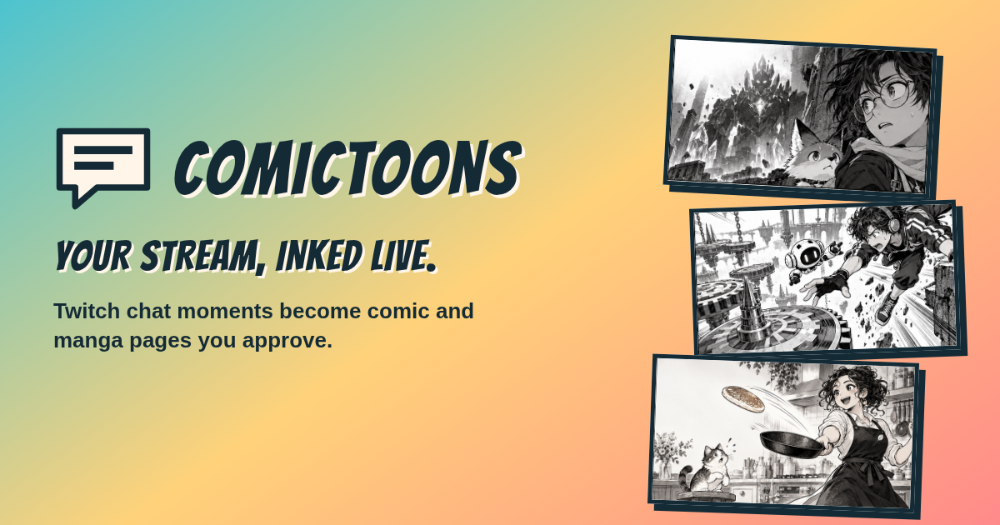
</p>

<h1 align="center">💬 ComicToons: <em>your stream, inked live</em></h1>

<p align="center">
  <b>Chat's best Twitch moments become comic and manga panels on your overlay. You approve every one. When you log off, the whole night is a comic you can share.</b><br>
  <sub>Codex × TwitchCon hackathon project · built with Codex</sub>
</p>

<p align="center">
  <a href="https://comictoons-demo.vercel.app"></a>
  <a href="https://youtu.be/GTMBXVyuo0o"></a>
  <a href="#️-installation"></a>
</p>

<p align="center">
  
  
  
  
  
  
  
  
  
</p>

<a id="-demo-video"></a>

## 🎬 Demo video

<p align="center">
  <a href="https://youtu.be/GTMBXVyuo0o">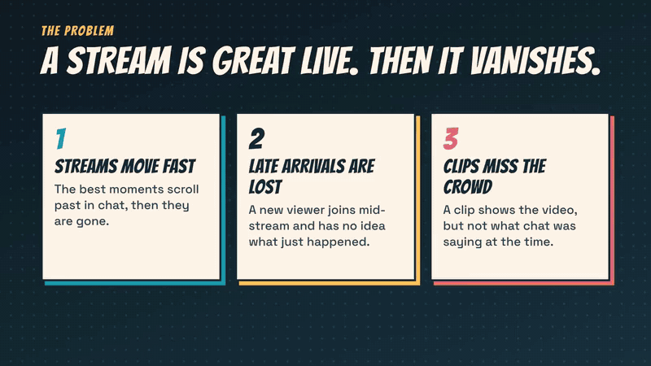</a><br>
  <sub>▲ Highlights, looping with no sound. Click it to watch the full narrated 4½-minute walkthrough on YouTube.</sub>
</p>

<p align="center">
  <a href="https://youtu.be/GTMBXVyuo0o"></a><br>
  <a href="https://youtu.be/GTMBXVyuo0o"><b>▶ Watch the full demo on YouTube (about 4½ minutes)</b></a> · <a href="https://comictoons-demo.vercel.app"><b>▲ Open the live demo</b></a><br>
  <sub>Prefer a file? <a href="docs/media/ComicToons-demo.mp4">Download the MP4</a> (about 49 MB).</sub>
</p>

The video covers the problem, what ComicToons is, how the pipeline fits together, and then one sample use case from start to finish: a streamer connects Twitch, a stream turns into comic panels in the Studio, the Audience view and Catch-up serve late arrivals, the Library offers a recap, comic book and manga series, and the clean overlay goes into OBS. Everything on screen was recorded from the running Sample demo, and the video states plainly that the Sample needs no keys while live use needs your own Twitch app and an image-provider key. It is narrated with Microsoft neural text-to-speech (the `en-GB-RyanNeural` voice, through `edge-tts`), captioned from the narration, and rendered with [Remotion](https://www.remotion.dev). The narration script is [`video/narration/script.json`](video/narration/script.json), and [`video/`](video) rebuilds the whole video.

<table align="center">
<tr>
<td align="center" width="33%">🎞️<br><b>Moments to pages</b><br><sub>Chat activity and captured video frames become a comic page the streamer reviews.</sub></td>
<td align="center" width="33%">✅<br><b>You approve every panel</b><br><sub>Release, Reject or Edit caption. Nothing airs unreviewed.</sub></td>
<td align="center" width="33%">📖<br><b>One story, two formats</b><br><sub>The same issue reads as a comic book or a manga series, with PNG export.</sub></td>
</tr>
</table>

---

<details open>
<summary><b>📑 Contents</b> (click to collapse)</summary>

- [🌟 What you can do](#-what-you-can-do)
- [🔑 What you need: keys and accounts](#-what-you-need-keys-and-accounts)
- [🖼️ What it looks like](#️-what-it-looks-like)
- [⚙️ How it works](#️-how-it-works)
- [🏗️ Architecture](#️-architecture)
- [🛠️ Installation](#️-installation)
- [🧪 Sample demo](#-sample-demo)
- [🔌 Configure Twitch once](#-configure-twitch-once)
- [📡 Live workflows](#-live-workflows)
- [🎨 Image providers and private configuration](#-image-providers-and-private-configuration)
- [👥 Audience view, Library and exports](#-audience-view-library-and-exports)
- [📺 OBS overlay](#-obs-overlay)
- [🔧 Configuration](#-configuration)
- [🩺 Troubleshooting](#-troubleshooting)
- [▲ Deployment: the Vercel Sample demo](#-deployment-the-vercel-sample-demo)
- [✅ Testing](#-testing)
- [🧰 Tech stack](#-tech-stack)
- [🗂️ Project structure](#️-project-structure)
- [🚧 Known limits](#-known-limits)
- [🙏 Credits](#-credits)

</details>

---

## 🌟 What you can do

Turn stream moments into a comic, review what goes on air, and give late arrivals a quick catch-up. Try the fictional Sample stream first, or connect Twitch and capture real video with matching chat.

| Experience | What it does | What you need |
| --- | --- | --- |
| Sample Studio | Simulates chat, panel releases, arrivals, raid catch-up, dialogue votes, a cameo and a prediction; saves a Sample issue | Nothing: no Twitch account, no keys (the hosted demo works the same way) |
| Read public chat only | Reads a channel’s chat without video capture or panel creation | **Your own Twitch app** (client ID and secret in `.env`) and your Twitch sign-in |
| Source-frame comic | Composes actual captured frames with attributed chat; your stream’s pages wait for review | **Your own Twitch app** and sign-in, playing Twitch video and explicit capture; no image API key |
| Illustrated comic | Analyses captured frames, draws a page and checks the result | **Your own Twitch app** plus **your own image-provider key** (OpenAI, Gemini, Pollinations or Cloudflare), model access and quota |
| Audience view | Shows released panels, On air / Catch-up switching and expandable interactions | Released Sample or Live content |
| Library | Groups saved issues with Create & export, collected books and manga readers | Released panels or a saved issue |
| OBS overlay | Presents released content without navigation in a Browser Source | Running app; OBS for broadcast use |

Comic book and manga are **two reading formats of the same story**. The landing page shows previews; **Read full comic book** and **Read full manga series** open the complete readers. Festival, Sunset, Lagoon and Blossom are the colour themes.

## 🔑 What you need: keys and accounts

**The Sample needs no keys.** The built-in Sample (and the [hosted demo](https://comictoons-demo.vercel.app)) runs with no Twitch account, no `.env` and no API keys.

**Using ComicToons on your own stream does need your own keys.** ComicToons never ships with any, and nobody can use yours. You supply:

| For | You provide | Where it goes |
| --- | --- | --- |
| Live Twitch (sign-in, chat, events) | A Twitch application you register yourself: `COMICTOONS_TWITCH_CLIENT_ID`, `COMICTOONS_TWITCH_CLIENT_SECRET` and `COMICTOONS_TWITCH_REDIRECT_URI` | Ignored `.env` ([setup](#-configure-twitch-once)) |
| Source-frame comics | No image key. Set `COMICTOONS_IMAGE_PROVIDER=source` | Ignored `.env` |
| Illustrated pages | A key for the provider you choose: `OPENAI_API_KEY`, `GEMINI_API_KEY`, `POLLINATIONS_API_KEY`, or `CLOUDFLARE_API_TOKEN` with `CLOUDFLARE_ACCOUNT_ID` | Ignored `.env` / `.env.images`, or the session form for one hour ([providers](#-image-providers-and-private-configuration)) |

Keep real values out of source, screenshots and archives. The narration and captions of the demo video say the same thing.

Sample and Live have separate chat, panels, catch-up, saved issues and output. Sample uses bundled art and local simulation; it does not prove that real Twitch capture or AI illustration passed review.

## 🖼️ What it looks like

Captured from the running Sample demo ([`video/capture/screenshots.mjs`](video/capture/screenshots.mjs) regenerates them). Story content is Sample art and a local simulation; these screenshots do not show live Twitch capture.

<table>
<tr>
<td width="50%">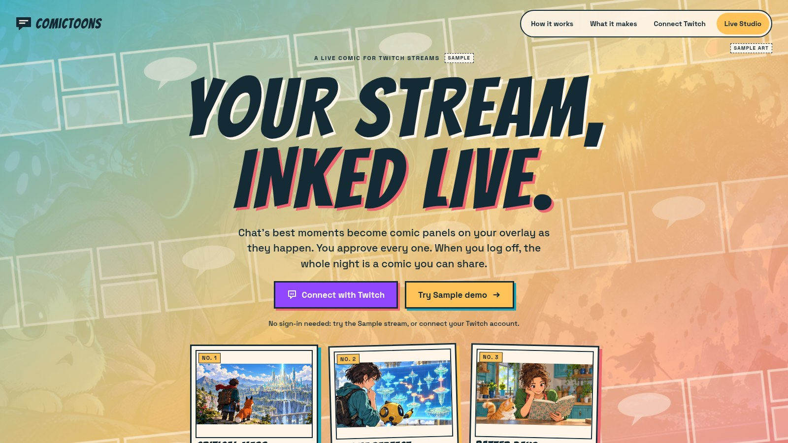<br><sub><b>Landing.</b> Connect Twitch or try the Sample demo, with a preview of three sample issues.</sub></td>
<td width="50%">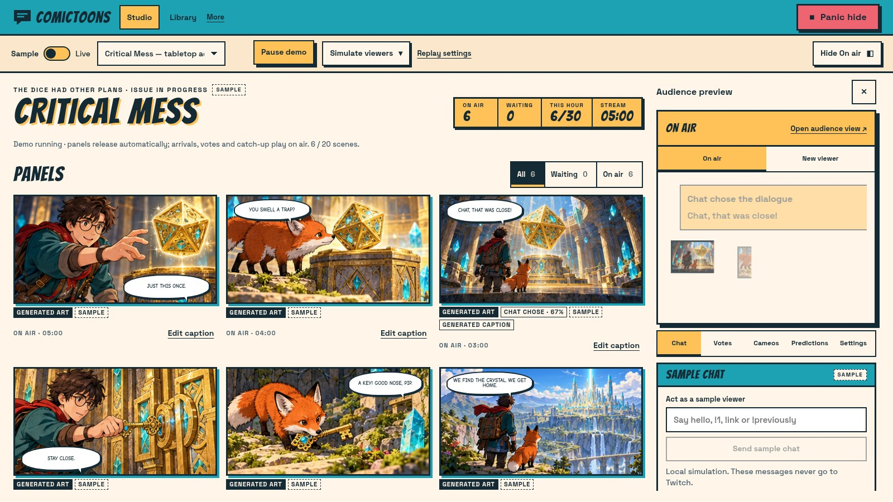<br><sub><b>Studio, mid-run.</b> Panels release as scenes unfold, with live counters and an audience preview.</sub></td>
</tr>
<tr>
<td>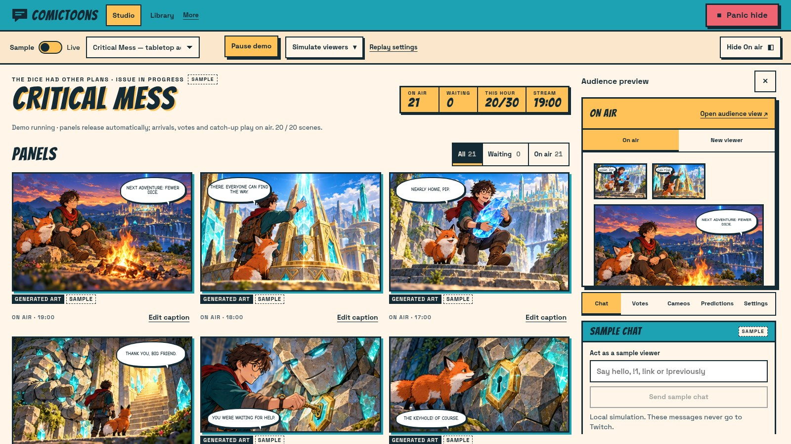<br><sub><b>Studio, finished.</b> All twenty scenes released and the issue ready to read.</sub></td>
<td>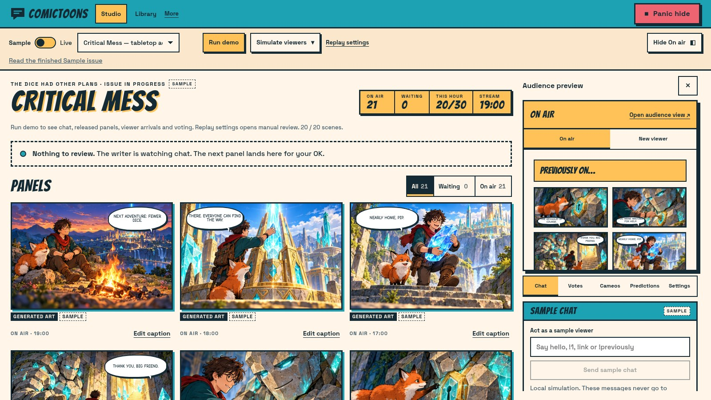<br><sub><b>Simulate viewers.</b> Arrivals, raids, votes, cameos and predictions, all local.</sub></td>
</tr>
<tr>
<td>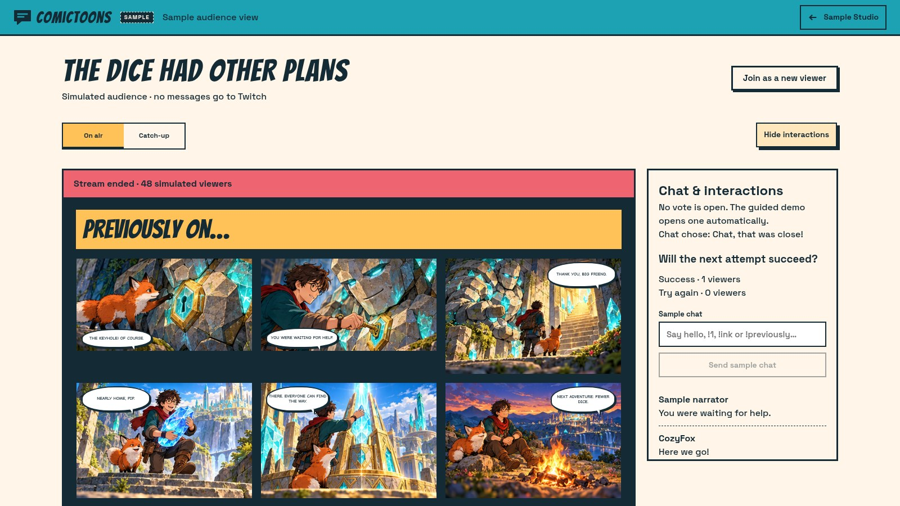<br><sub><b>Audience view.</b> On air or Catch-up, with chat and votes one click away.</sub></td>
<td>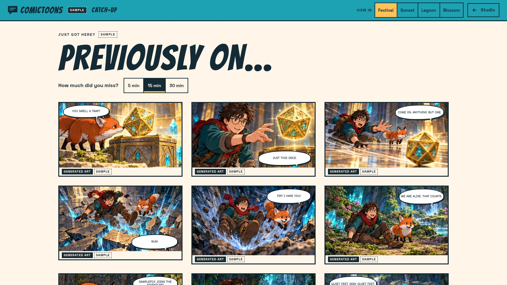<br><sub><b>Catch-up.</b> A short "Previously on..." preview for late arrivals and raiders.</sub></td>
</tr>
<tr>
<td>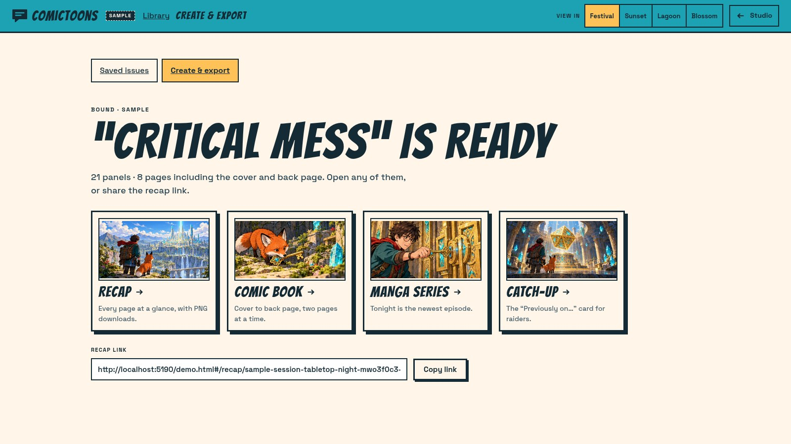<br><sub><b>Create &amp; export.</b> Recap, comic book, manga series and catch-up from one issue.</sub></td>
<td>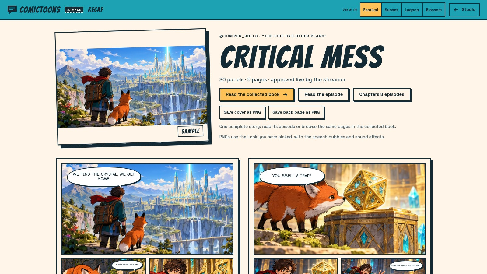<br><sub><b>Recap.</b> Every page at a glance, with PNG downloads.</sub></td>
</tr>
<tr>
<td>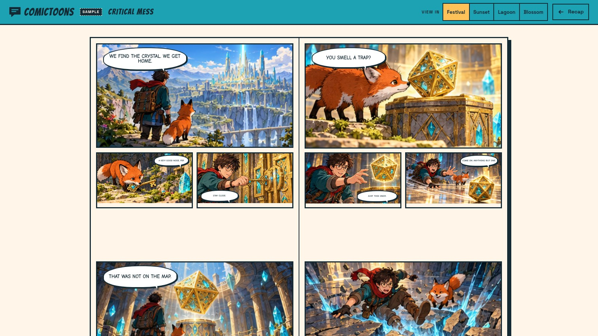<br><sub><b>Comic book.</b> Cover to back page, two pages at a time.</sub></td>
<td>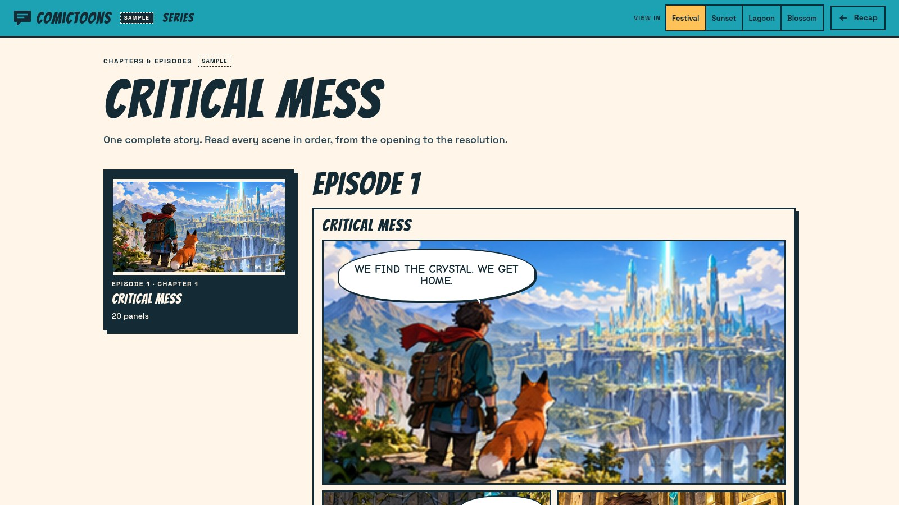<br><sub><b>Manga series.</b> The same story, episode by episode.</sub></td>
</tr>
<tr>
<td>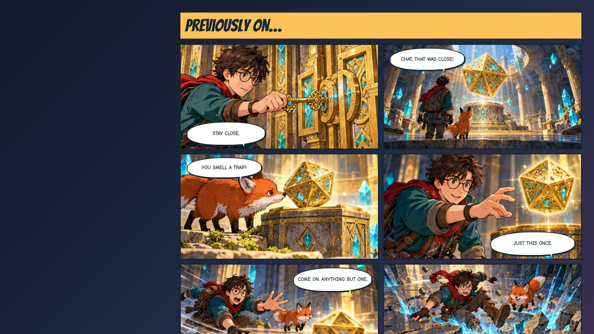<br><sub><b>OBS overlay.</b> Navigation-free output (shown on a dark stand-in canvas).</sub></td>
<td>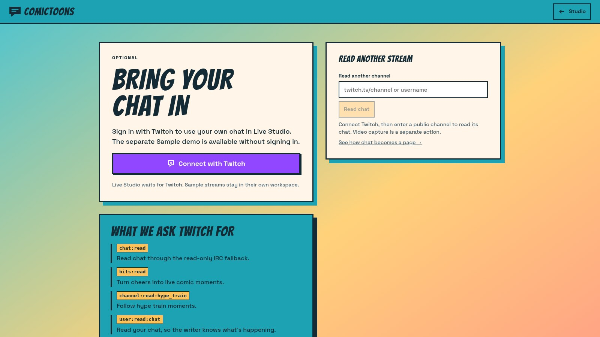<br><sub><b>Connect.</b> Sign in with Twitch, or read public chat read-only.</sub></td>
</tr>
</table>

<p align="center">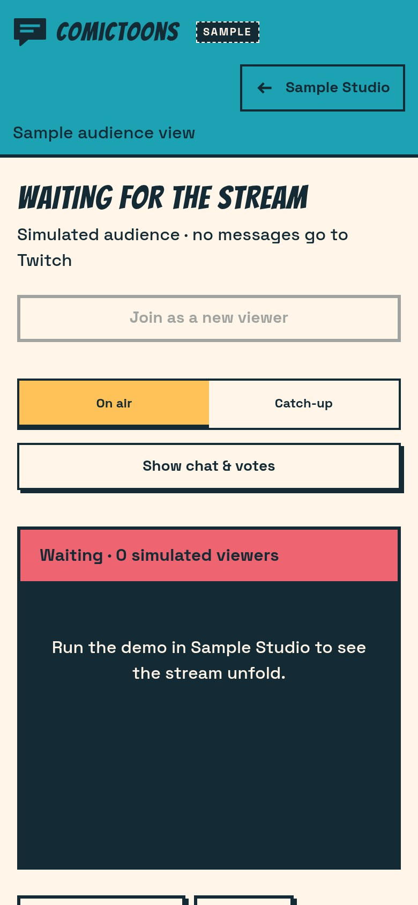<br><sub><b>Phone audience view.</b> The audience screens are built for a phone.</sub></p>

## ⚙️ How it works

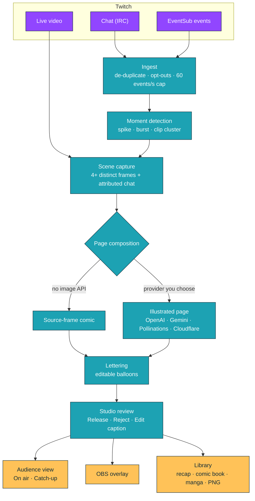

<sub>Purple = Twitch. Teal = ComicToons server and Studio. Amber = outputs.</sub>

### 1. Moments are found in chat

Input admission deduplicates events, respects deletes and opt-outs, and rate-limits accepted events to 60 per second. A candidate moment opens on a **spike** (at least six messages from three distinct users in ten seconds, at least three times the trailing baseline, after 30 seconds of warm-up), a **burst** (three distinct users repeat a recognised token such as KEKW, LUL, GG or "clip it" within eight seconds) or a **clip cluster** (three distinct polled clips within 120 seconds). Cooldowns stop one moment opening repeatedly. Scores are sums of per-event weights, not model confidence.

### 2. Real frames become a page

Capture needs Twitch video playing and at least four distinct frames. A **source-frame comic** composes the actual captured frames with attributed chat and needs no image API key. An **illustrated comic** analyses the frames, draws a page through the provider you select, and checks the result. Chat is commentary, not streamer speech, and there is no audio transcription.

### 3. The streamer reviews, then it airs

Pages from your own stream wait in Studio review. **Release** puts a page on air, **Reject** excludes it, and **Edit caption** starts an eligible revision. Panic hide blanks ComicToons output instantly while panels keep arriving.

### 4. The same story, everywhere

Released panels reach the **Audience view** (On air and Catch-up), the **OBS overlay**, and the **Library**, which groups saved issues and offers a recap, a comic book, a manga series, a catch-up card and PNG downloads.

## 🏗️ Architecture

| Layer | What it does |
| --- | --- |
| `apps/web` | React 19 + Vite landing page, Studio, Audience, Catch-up, Library, readers and the overlay |
| `apps/server` | Fastify 5 API: Twitch OAuth, IRC and EventSub ingest, moment detection, scene capture, image providers, participation, exports |
| `packages/core` | Shared types, colour themes, lettering and layout rules, environment helpers |
| Sample demo | `apps/web/demo.html` runs the same UI against a bundled `MockAdapter`, so it needs no server, keys or Twitch |

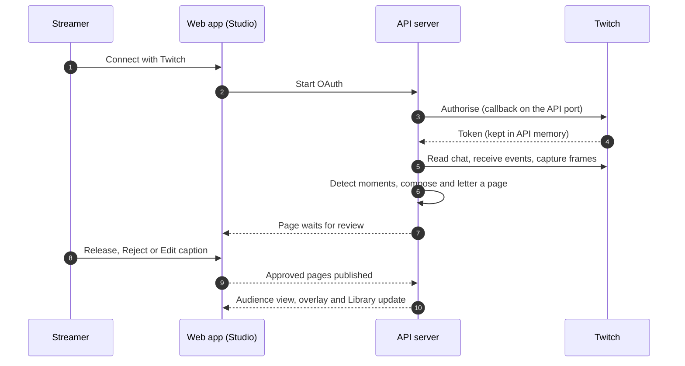

## 🛠️ Installation

### 1. Prerequisites

- Install [Node.js](https://nodejs.org/en/download) with npm. **Node 24 is the validated local setup**: 24.20.0 with npm 11.19.0. The package declares Node `>=20`; that is not a claim that every older release works with all dependencies.
- Use a recent browser. Install Git if you want to clone instead of downloading a ZIP.
- OBS is optional and needed only for broadcast-overlay use.

Check the terminal can find Node and npm:

```sh
node --version
npm --version
```

On Windows, reopen the terminal after installing Node. If PowerShell blocks `npm.ps1`, use `npm.cmd` and `npx.cmd` below; changing the machine’s execution policy is not required.

### 2. Get the source

Open the [repository](https://github.com/TYK3/ComicToons), choose **Code → Download ZIP**, and extract it. With Git:

```sh
git clone https://github.com/TYK3/ComicToons.git
cd ComicToons
```

Run commands from the root containing `package.json`, not `apps/web`. A GitHub download contains exactly the files in the repository, with no private environment files.

### 3. Dependencies and Chromium

```sh
npm ci
npx playwright install chromium
```

`npm ci` uses the lockfile and installs `sharp` for image composition. Playwright Chromium is used for capture and server-side image export. The downloads need internet access.

On Linux, if Playwright reports missing OS libraries:

```sh
npx playwright install --with-deps chromium
```

This may request permission to install system packages. Resolve browser-download or proxy errors before trying real capture.

### 4. Start the app

```sh
npm run dev
```

Keep the terminal open. Default addresses:

| Service | Address |
| --- | --- |
| Landing | [http://localhost:4173/](http://localhost:4173/) |
| Sample Studio | [http://localhost:4173/ui.html#/studio?workspace=sample](http://localhost:4173/ui.html#/studio?workspace=sample) |
| Live Studio | [http://localhost:4173/ui.html#/studio?workspace=live](http://localhost:4173/ui.html#/studio?workspace=live) |
| API state | [http://localhost:3001/api/state](http://localhost:3001/api/state) |
| Twitch callback | `http://localhost:3001/auth/twitch/callback` |

Open the **web port** to use the product. Vite proxies `/api`, `/auth`, `/art`, `/exports` and `/qa` to the API. Press **Ctrl+C** to stop the app.

`npm run demo` is an alternative launcher: it installs Chromium, starts both services and opens the landing page. It always opens a browser. Choose Sample in the app; the launcher does not erase existing configuration or disable a configured provider.

### Custom ports: the existing 3122 / 4122 setup

Set **both ports in the shell before starting**. The API loads `.env`, but Vite’s port/proxy configuration reads the process environment. Putting ports only in `.env` can leave the services using different configurations.

PowerShell:

```powershell
$env:COMICTOONS_API_PORT = '3122'
$env:COMICTOONS_WEB_PORT = '4122'
npm run dev
```

Bash / zsh:

```sh
COMICTOONS_API_PORT=3122 COMICTOONS_WEB_PORT=4122 npm run dev
```

Use [web port 4122](http://localhost:4122/ui.html#/studio?workspace=sample) and callback `http://localhost:3122/auth/twitch/callback`. Register that exact callback in Twitch and put the same URI in your private configuration. The API and web ports are different; they must form a matching pair.

PowerShell `$env:` values last for that terminal session. Open a new terminal for a clean environment, or remove a specific setting with `Remove-Item Env:COMICTOONS_API_PORT`. Startup fails if a requested port is already occupied.

## 🧪 Sample demo

1. Open Sample Studio. The **Sample / Live** switch stays beside the stream selector while you scroll.
2. Click **Run demo**. Scenes release automatically and audience activity is simulated. Selecting another invented stream starts its guided demo.
3. **Pause demo / Resume demo** preserves your place. **Replay settings → Restart replay** starts manual review, where panels wait for Release, Reject or Edit caption. Manual replay speed is separate from the guided run.
4. Open **Simulate viewers** (**Simulator** on a phone). Try a viewer arrival, raid, vote, prediction or cameo; the sidebar shows the result on the same page.
5. Swap **On air / New viewer** in the preview. The lower **Chat / Votes / Cameos / Predictions / Settings** tabs show one controls group at a time. Close the drawer on narrow screens to use producer controls.
6. Open **Audience view** for **On air / Catch-up**, **Show chat & votes**, and **Join as a new viewer**. Sample votes/messages stay local.
7. A finished guided run binds an issue automatically. For a manual run, release panels, then use **More → End stream** or **Library → Create & export**.

Invented streams: Critical Mess (`tabletop-night`), Frame Perfect (`speedrun-fail`) and Batter Days (`irl-cooking`). The separate Jynxzi QA example uses manual replay and is labelled chat-inspired interpretation, not verified footage.

Sample time advances by one simulated minute per scene. Catch-up windows use story time, not the accelerated wall clock. Keep the driving Studio tab open. Sample state/issues are saved in this browser’s local storage; export a separate copy before clearing browser data. Restarting replay clears current output, not saved issues.

## 🔌 Configure Twitch once

Sample needs no `.env` and no keys. **Live needs your own Twitch app credentials** (and an image-provider key only if you want illustrated pages; see [What you need](#-what-you-need-keys-and-accounts)). Copy the example **only if your private file does not already exist**.

PowerShell:

```powershell
if (-not (Test-Path .env)) { Copy-Item .env.example .env }
```

Bash / zsh:

```sh
if [ ! -f .env ]; then cp .env.example .env; fi
```

1. [Register your application with Twitch](https://dev.twitch.tv/docs/authentication/register-app/) using your own account. The official guide explains verification and 2FA requirements.
2. Add the exact callback for your port pair, including `http`, hostname, API port and `/auth/twitch/callback`, with no trailing slash.
3. Save the client ID and secret only in ignored `.env`. A source-frame starting configuration is:

```dotenv
COMICTOONS_TWITCH_CLIENT_ID=replace_with_your_client_id
COMICTOONS_TWITCH_CLIENT_SECRET=replace_with_your_client_secret
COMICTOONS_TWITCH_REDIRECT_URI=http://localhost:3001/auth/twitch/callback
COMICTOONS_IMAGE_PROVIDER=source
```

For ports 3122 / 4122, use `http://localhost:3122/auth/twitch/callback` instead and launch with both shell port variables.

4. Restart after environment edits. Open Live Studio, then **Connect with Twitch** or **Twitch account**. Complete sign-in/consent yourself.
5. Choose **Streamer** for your own channel. Start your broadcast separately in OBS or your streaming software; ComicToons does not start it.

Tokens stay in API-server memory; a restart requires sign-in again. For private server settings, precedence is shell values, then `.env`, then optional `.env.images`. Port variables belong in the shell as described above. [Detailed Twitch setup](docs/twitch-setup.md).

## 📡 Live workflows

### Read chat without capturing video

Open **Live setup → Read public chat only**, enter a username or Twitch URL, and press **Read chat**. The same picker is on Connect.

This reads chat without starting capture, creating panels, posting messages or changing your role. Other-channel reading does not grant broadcaster controls. **Use my channel** returns to your channel; **Stop reading** stops that input while keeping the workspace in Live.

### Create pages from video

1. For your channel, open **Live setup → Create pages from my live video**.
2. Expand **Page creation settings**. Choose **Use source-frame comic · no image API**, or explicitly configure an illustrated provider.
3. Choose 2, 5 or 10 minutes under **Capture duration**. Start with 2 minutes and a one-page limit for a small test.
4. Press **Capture my stream for 2 minutes** (the label follows your selected duration). Twitch video must be playing. At least four distinct captured frames are needed before page composition.
5. Inspect completed pages and source evidence. Streamer pages enter Studio review. **Release** shows a page, **Reject** excludes it, and **Edit caption** starts an eligible revision. `A`, `R`, `E` shortcuts can be disabled in Settings.
6. Stop capture when finished. Binding a comic and stopping an OBS broadcast are separate actions.

For another channel, open **Live setup → Capture another channel’s video**, then its capture-setup button. This explicitly enters **Viewer** setup. Choose settings/duration before pressing **Capture this stream for … minutes**. Viewer capture makes your viewing comic; it cannot approve, hide or manage that broadcaster’s stream. **Studio** returns to Streamer setup.

**Approved history is not a Twitch-wide comic library.** Viewer can show pages released by the connected broadcaster on this ComicToons server. Arbitrary channels may have no shared history. A load failure has a retry state, separate from “no released pages.”

Use **Live setup → Create pages from a VOD or clip** for the separate capped import workflow. See [clip/VOD details](docs/make-from-link.md).

### Votes, cameos and catch-up

Sample supplies its own local interactions. Real participation uses server flags and connected-channel capabilities:

```dotenv
COMICTOONS_PARTICIPATION_MOCK=0
COMICTOONS_FLAG_POLLS=1
COMICTOONS_FLAG_CATCHUP=1
COMICTOONS_FLAG_DIRECTOR=1
COMICTOONS_FLAG_NOINK=1
# Optional extras for eligible channels:
COMICTOONS_FLAG_TWITCH_POLLS=1
COMICTOONS_FLAG_INK_ME=1
COMICTOONS_FLAG_HYPE=1
```

Most flags default off; `NOINK` defaults on. Basic chat reading and source-frame composition need no Affiliate status. Native polls, predictions and channel-point rewards depend on Twitch eligibility/permissions; chat-vote fallback is available where supported.

For a real dialogue vote, keep two distinct ordinary chat lines fresh, choose an eligible waiting or released panel, open **Votes**, and start the vote. Viewers type the displayed `!1`, `!2` or `!3` in Twitch chat. Commands are not story dialogue. A revision succeeds when applied; “rendering” is unfinished and “image-failed” is a failure. Source-frame lettering composes locally; illustrated revisions can require provider calls.

Chat is commentary, not streamer speech. There is no audio transcription. `!noink` opts a viewer out of supported quotation/participation paths.

## 🎨 Image providers and private configuration

Source-frame comics use actual frames and attributed lettering, without an external image API or AI illustration, so they need no image key (live use still needs your Twitch app credentials). Illustrated pages need **your own key** for one of these providers, entered in **Page creation settings** or kept in `.env`:

| Choice | Private server defaults |
| --- | --- |
| Source frames | `COMICTOONS_IMAGE_PROVIDER=source` |
| OpenAI | `COMICTOONS_IMAGE_PROVIDER=openai`, `OPENAI_API_KEY`, optional `OPENAI_IMAGE_MODEL` |
| Gemini | `COMICTOONS_IMAGE_PROVIDER=gemini`, `GEMINI_API_KEY`, optional `GEMINI_IMAGE_MODEL` |
| Pollinations | `COMICTOONS_IMAGE_PROVIDER=pollinations`, `POLLINATIONS_API_KEY`, optional `POLLINATIONS_REFERENCE_MODEL` |
| Cloudflare | `COMICTOONS_IMAGE_PROVIDER=cloudflare`, `CLOUDFLARE_API_TOKEN`, matching `CLOUDFLARE_ACCOUNT_ID`; optional `CLOUDFLARE_REFERENCE_SLOT` and `CLOUDFLARE_REFERENCE_MODEL` |

Or enter your own key for one session. Cloudflare also needs its matching account ID. Choose from the current model dropdown; provider access/quota can change. [OpenAI walkthrough](docs/OPENAI_SETUP.md).

Session keys stay in server memory for up to one hour, not browser storage. A configured provider can run automatically during capture up to the page-attempt limit. Analysis, drawing, review and failed attempts can incur charges. **Check connection** does not guarantee credits or image quality. The attempt limit is not a dollar cap.

`COMICTOONS_ART_NETWORK` controls the legacy art path, not the scene-capture generator. To avoid image-provider calls, explicitly select Source-frame comic. Reference generation does not silently swap providers when the selected provider fails.

Keep real credentials in ignored `.env` / `.env.images` or the session form, never in source, screenshots, archives or `VITE_` variables. **Use app default / forget my key** removes the session key but can switch back to a configured server default; it does not necessarily disable generation.

## 👥 Audience view, Library and exports

- **Audience view:** open from Studio preview or More. Swap **On air / Catch-up**, choose the time window, and expand **Show chat & votes**. Sample controls simulate a viewer; Live commands are entered in Twitch chat. The Studio return remains available.
- **Library → Saved issues:** browse the active workspace’s comics and open an issue, book or manga series. Failed issue requests show recovery UI rather than a false empty library.
- **Library → Create & export:** choose title/formats and bind released panels. Recap/book/series links preserve the workspace; use their PNG download controls for portable images.
- **Local links:** a localhost recap URL does not publish anything. Others need access to the server; Sample issues additionally depend on that browser’s saved data. Export files for a portable copy.

## 📺 OBS overlay

Open the preview first; it has return navigation. For OBS, choose **Clean OBS output** and use `obs=1` with an explicit workspace:

```text
http://localhost:4173/ui.html#/overlay?workspace=live&obs=1
http://localhost:4173/ui.html#/overlay?workspace=sample&obs=1
```

Replace `4173` with `4122` for the existing web port. Keep ComicToons running and the driving Studio tab open for Sample playback. Add an OBS Browser Source, disable **Local file**, use your canvas resolution (for example 1920 × 1080), position it, and inspect the result. **Panic hide** blanks ComicToons output while panels can keep arriving.

Clean output intentionally has no navigation; operate through a separate Studio/audience tab. [Full OBS setup](docs/OBS_SETUP.md).

## 🔧 Configuration

[.env.example](.env.example) contains placeholders, not shared credentials. Main settings:

| Setting | Effect / default |
| --- | --- |
| `COMICTOONS_API_PORT` / `COMICTOONS_WEB_PORT` | Shell settings; defaults 3001 / 4173 |
| `COMICTOONS_OPEN=0` | Suppresses browser opening for `npm run dev`; the demo explicitly opens one |
| `COMICTOONS_TWITCH_CLIENT_ID` / `_CLIENT_SECRET` / `_REDIRECT_URI` | Twitch credentials and exact callback |
| `TWITCH_CHANNEL` | Optional chat-channel fallback; explicit UI selection wins |
| `COMICTOONS_IMAGE_PROVIDER` | Explicit `source`, `openai`, `gemini`, `pollinations`, `cloudflare` |
| `COMICTOONS_FLAG_*` | Participation switches above; true values include `1`, `true`, `on`, `yes` |
| `COMICTOONS_PARTICIPATION_MOCK=0` | Disables mock participation for real verification |
| `COMICTOONS_PANEL_BUDGET_PER_HOUR` / `IMAGE_BUDGET_PER_HOUR` | Legacy/participation art budget; default 12. Scene capture also has a per-session attempt limit |
| `COMICTOONS_ART_NETWORK` | Opt-in legacy art path, not a master scene-generator switch |
| `COMICTOONS_DIRECTOR_KEY` | Optional secret required in `x-comictoons-director-key` for Studio-changing requests |
| `COMICTOONS_WEB_EXPOSE=1` | Opts dev web server into LAN binding; loopback by default |
| `COMICTOONS_SERVE_WEB=1` | API serves built web assets; build first. Also changes its listening interface |
| `COMICTOONS_TWITCH_ANON=1` | Separate operator opt-in to signed-out receive-only IRC; UI reading still asks for sign-in |

The shared environment helper accepts legacy `PANELCAST_*` aliases for settings using it. Twitch credentials also fall back to `TWITCH_CLIENT_ID`, `TWITCH_CLIENT_SECRET`, `TWITCH_REDIRECT_URI`. Prefer current names.

Director access protects local writes; Viewer sessions remain restricted from broadcaster APIs. Exposing a server is a separate hosting/security task, not something copying a recap link accomplishes.

## 🩺 Troubleshooting

| Symptom | What to do |
| --- | --- |
| Node/npm missing | Install Node with npm, reopen the terminal and check versions. Try `npm.cmd` if PowerShell blocks the script |
| `npm ci` cannot find the project | Open the root containing `package.json` and `package-lock.json` |
| Chromium missing | Run `npx playwright install chromium`; on Linux install reported OS dependencies |
| Port occupied | Stop your duplicate app process or select another shell port pair; update Twitch’s API callback |
| Web cannot reach API | Keep both processes running; align Vite’s proxy and backend ports. Do not set ports only in `.env` |
| `redirect_mismatch` | Match registered/configured URI exactly: hostname, API port, path, no trailing slash. Restart after edits |
| Twitch disconnected after restart | Sign in again; tokens are in API memory |
| Read chat creates no pages | Correct for chat-only mode. Choose video capture and page settings |
| No frames | Channel must be live and video playing. Inspect ad/offline/player errors; Sample art is not substituted |
| Frames but no page | Wait for four distinct frames, choose Source frames or a provider, check attempts and held/failed reasons |
| Provider access/quota error | Check provider, account, model and quota. Explicitly select Source frames if appropriate; failed art is not success |
| Polls/rewards unavailable | Check flags, account capabilities and scopes; use displayed chat-vote fallback where available |
| Library/history unavailable | Retry and check the API; an error is different from no saved/released pages |
| Phone form is covered | Close the On air drawer; use Show On air to reopen it |
| Cannot return from overlay | Use the preview’s Studio return. Clean OBS output has no controls; keep a separate Studio tab |
| Recap link fails on another device | `localhost` points at that device. Export a file or separately configure an accessible server |

## ▲ Deployment: the Vercel Sample demo

The Sample demo is a static site hosted on Vercel at **[comictoons-demo.vercel.app](https://comictoons-demo.vercel.app)**. It runs the bundled Sample data through `MockAdapter` (`apps/web/src/ui/demo-main.tsx`), so the hosted demo needs no API server, no Twitch sign-in and no keys. Running ComicToons live on your own stream does need your own Twitch app and, for illustrated pages, an image-provider key (see [What you need](#-what-you-need-keys-and-accounts)).

- **Build:** `npm run build:demo` writes `apps/web/dist-demo` (about 75 MB, mostly Sample art).
- **Config:** [`vercel.json`](vercel.json) sets `npm ci`, the build command, the output directory and a rewrite of `/` to `/demo.html`.
- **Environment:** set no environment variables on the Vercel project and never add `.env` values there.
- **Updates:** the Vercel project is connected to this repository, so every push to `main` redeploys the demo.
- **Routes** are hash-based: [`/#/studio?workspace=sample`](https://comictoons-demo.vercel.app/#/studio?workspace=sample) (press **Run demo**), [`/#/overlay?workspace=sample`](https://comictoons-demo.vercel.app/#/overlay?workspace=sample), [`/#/recap/sample-tabletop-night?workspace=sample`](https://comictoons-demo.vercel.app/#/recap/sample-tabletop-night?workspace=sample) and [`/#/book/sample-tabletop-night?workspace=sample`](https://comictoons-demo.vercel.app/#/book/sample-tabletop-night?workspace=sample).
- Live Twitch features (Connect with Twitch, live chat, panel generation) need the API and run locally. More in [docs/VERCEL_DEMO.md](docs/VERCEL_DEMO.md).

## ✅ Testing

```sh
npm run typecheck
npm run lint
npm run test
npm run build
npm run e2e
npm run test:twitch -- --gate
npm run test:obs
npm run e2e:import-wire
npm run secrets
```

`npm run check` combines typecheck, lint and unit/contract tests. `npm run gate` also runs mock Twitch, builds, browser/OBS/import suites, the secret scan, the dependency audit and fresh-clone checks.

Browser tests use isolated loopback services. Default e2e ports are API 4301 / web 4273. For occupied test ports:

```powershell
$env:COMICTOONS_E2E_API_PORT = '4401'
$env:COMICTOONS_E2E_WEB_PORT = '4373'
npx playwright test -c tests/playwright.config.ts tests/ux-refinement.spec.ts
```

### Verified status

`npm run check` passes on the current `main`: TypeScript typecheck, ESLint and **834 unit and contract tests** (Node 24, with Playwright Chromium installed for the export tests). The browser, mock-Twitch, OBS and fresh-clone suites run through `npm run gate`.

## 🧰 Tech stack

| Area | Tools |
| --- | --- |
| Front end | React 19, Vite 6, TypeScript, locally served fonts (Bangers, Comic Neue, Space Grotesk) |
| Server | Node 24, Fastify 5, `sharp` for image composition, Playwright Chromium for capture and server-side export |
| Twitch | OAuth, IRC chat, EventSub, Helix API |
| Illustration | Source frames (no API), OpenAI, Gemini, Pollinations, Cloudflare |
| Quality | Playwright end-to-end tests, axe-core accessibility checks, a mock Twitch harness, ESLint, a secret scan |
| Hosting | Vercel for the static Sample demo, OBS Browser Source for the overlay |
| Demo video | Remotion, Playwright screen capture, FFmpeg, Microsoft neural TTS (`edge-tts`) for the narration |

## 🗂️ Project structure

| Path | Purpose |
| --- | --- |
| `apps/web/` | React/Vite landing, workspaces, audience/overlay, Library and readers |
| `apps/server/` | Fastify, Twitch auth/ingestion, capture, generation, participation, exports |
| `packages/core/` | Shared types, themes, layout/lettering rules and environment helpers |
| `fixtures/` / `apps/web/public/samples/` | Test and Sample assets |
| `tests/` / `scripts/` | Automated checks, launchers, harnesses and secret scans |
| `docs/` | Setup guides, QA references and current screenshots |
| `exports/` / `artifacts/` | Local output/evidence; review ignore rules before packaging |
| `video/` | Remotion project and Playwright capture scripts that rebuild the demo video |

## 🚧 Known limits

- Chat is commentary, not streamer speech. There is no audio transcription, and quotations are attributed to Chat.
- Sample mode uses bundled art and a local simulation. It does not prove that real Twitch capture or AI illustration passed review.
- Source-frame output and AI illustration are labelled differently on purpose. An illustrated page depends on your provider's access, quota and model, and a failed attempt is shown as failed.
- Approved history is not a Twitch-wide comic library. Viewer shows pages released by the connected broadcaster on this ComicToons server.
- Tokens live in API-server memory, so restarting the server means signing in to Twitch again.
- Native Twitch polls, predictions and channel-point rewards depend on the channel's Twitch eligibility and permissions. Chat votes work where those are unavailable.
- A localhost recap link publishes nothing. Export a file for a portable copy.

## 🙏 Credits

Built by **Tyk Anthony** (TYK3) for the Codex × TwitchCon hackathon. The owner supplied product direction, visual requirements, approval rules and testing authorisation. Codex implemented the UI, Twitch integration, capture, provider adapters, lettering, review, participation, export, tests and documentation. Live images come through the app's selected provider.

- Fonts: Bangers, Comic Neue and Space Grotesk, all under the SIL Open Font Licence (see `apps/web/src/ui/fonts`).
- Sample art provenance and licence notes: [fixtures/art/generated/LICENSE-NOTE.md](fixtures/art/generated/LICENSE-NOTE.md). Dependency and licence review: [docs/DEPENDENCIES.md](docs/DEPENDENCIES.md). Lettering maps: [docs/LETTERING_MAPS.md](docs/LETTERING_MAPS.md).
- The speech-bubble logo is drawn for ComicToons and is not taken from any brand kit. The Connect glyph is a generic chat bubble, not the Twitch logo.
- Demo video narration is generated with Microsoft neural text-to-speech through [`edge-tts`](https://github.com/rany2/edge-tts) by [`video/narration/make_voice.py`](video/narration/make_voice.py). The music is an original ambient bed synthesised by [`video/capture/make_music.py`](video/capture/make_music.py).

Copyright © 2026 Tyk Anthony. All rights reserved.

<p align="center">
  <br>
  <sub>Never package private environment files, stream keys, captures or chat logs. A ZIP made from a working folder can contain ignored files; a GitHub ZIP contains only what is in the repository.</sub>
</p>
