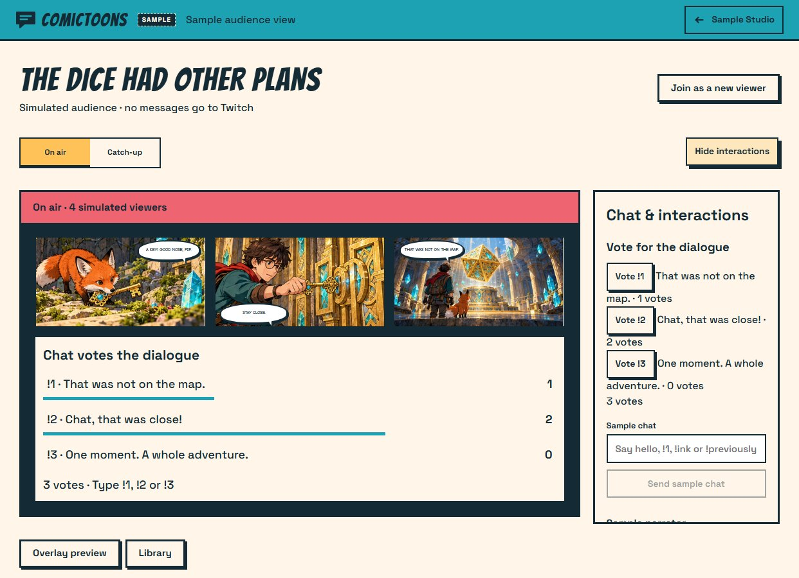

# ComicToons overlay in OBS

Updated 3 November 2026. This guide uses the current workspace-aware overlay. Adding a Browser Source does not start a Twitch broadcast.

## Prepare the app

1. Follow [installation](../README.md#️-installation) and keep ComicToons running.
2. Open Sample or Live Studio on the **web** port. Run the guided Sample demo, or capture/review/release Live pages.
3. Open **More → Overlay**. The preview includes **Back to Sample/Live Studio**, **Viewer screen** and **Clean OBS output**.
4. Choose **Clean OBS output** for the address to use in OBS. Keep Studio open separately; the clean page has no navigation.

Default URLs:

```text
http://localhost:4173/ui.html#/overlay?workspace=live&obs=1
http://localhost:4173/ui.html#/overlay?workspace=sample&obs=1
```

Replace **4173** with **4122** for the existing setup. The workspace keeps Sample and Live separate; `obs=1` removes preview controls. Do not use the audience page or a non-clean preview as the broadcast source.

## Add the Browser Source

Add a Browser Source in your OBS scene. Use the following setup, based on the [official Browser Source reference](https://obsproject.com/kb/browser-source):

| Property | Setting |
| --- | --- |
| Local file | Off |
| URL | One clean workspace URL above, with your web port |
| Width / Height | Match your canvas, for example 1920 × 1080 |
| Use custom frame rate | Off unless you need a custom rate |
| Custom CSS | Keep OBS’s transparent-background default |
| Shutdown source when not visible | Leave off while testing live updates |
| Refresh browser source when scene becomes active | Leave off initially |

Place the source above the game/camera layer. Position and size it, check lettering at broadcast size, and keep faces/action visible. The current output is responsive; older fixed strip-size/placement measurements do not describe this view.

## Verify before broadcasting

1. Release a Live page, or run the Sample demo. Only released content should appear.
2. Check the workspace. Sample art must not be presented as captured Live footage.
3. Test **Panic hide**, then show the overlay. Hiding does not stop capture or your public broadcast.
4. Test catch-up/voting in the intended workspace. Use **Audience view** for interactive inspection while OBS stays on clean output.
5. Inspect the actual OBS preview: text size, crops, source order and transparency. Chromium screenshots do not prove the result inside OBS.

Keep the driving Studio tab open for Sample playback. Live updates need the app/API running. An API restart requires Twitch sign-in again; inspect the output after reconnecting.

For stale content or a changed URL, use **Refresh cache of current page** in Browser Source properties. For empty output, first check the app/web port, workspace, released panels and hidden state. Clean output has no recovery controls; operate from Studio or hide the source in OBS.

## Audience view versus OBS



Audience view has On air / Catch-up, a time window, expandable interactions and a Studio return. It is for review/demonstration. Clean OBS output omits navigation and presents the workspace’s released content.

## Automated checks

Run `npm run test:obs` separately from `npm run e2e`. The harness uses isolated loopback services; see [its port configuration](../tests/obs/playwright.config.ts). The maintainer-owned full gate runs suites in order. These checks do not certify a real broadcast or your OBS layout.
