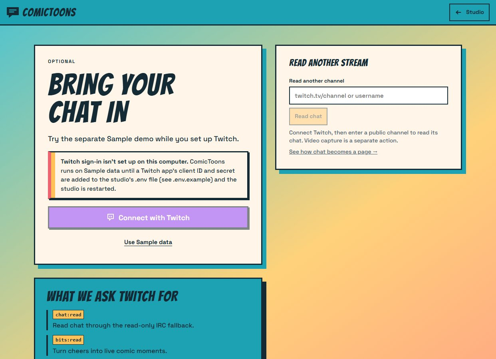

# Twitch setup for ComicToons

Updated 3 November 2026. Start with the [installation guide](../README.md#️-installation). Sample mode needs no Twitch credentials.

## Match the ports and callback

| Setup | Web | API | Register this callback |
| --- | --- | --- | --- |
| Defaults | `http://localhost:4173/` | `http://localhost:3001/` | `http://localhost:3001/auth/twitch/callback` |
| Existing local setup | `http://localhost:4122/` | `http://localhost:3122/` | `http://localhost:3122/auth/twitch/callback` |

Set API and web ports in the **shell**, not only `.env`, so the backend, Vite proxy and callback agree. See [custom-port commands](../README.md#custom-ports-the-existing-3122--4122-setup). Do not mix `localhost` and `127.0.0.1` in the registered/configured callback, change its path, or add a trailing slash.

## Register and connect

1. [Register an app with Twitch](https://dev.twitch.tv/docs/authentication/register-app/). Complete the account verification and 2FA prerequisites in Twitch’s guide.
2. Add the callback for your API port. Generate the client secret and keep it private.
3. Copy `.env.example` only if `.env` does not exist. Set these placeholders in your private file:

   ```dotenv
   COMICTOONS_TWITCH_CLIENT_ID=replace_with_your_client_id
   COMICTOONS_TWITCH_CLIENT_SECRET=replace_with_your_client_secret
   COMICTOONS_TWITCH_REDIRECT_URI=http://localhost:3001/auth/twitch/callback
   COMICTOONS_IMAGE_PROVIDER=source
   ```

   Change the redirect port to 3122 for the existing setup.
4. Restart, open `ui.html#/studio?workspace=live` on the web port, and choose **Connect with Twitch** or **Twitch account**. Finish authorization in Twitch yourself.
5. Choose **Streamer** for your own channel. ComicToons does not start OBS or begin a broadcast.



Tokens stay in API-server memory; reconnect after restarting. Current names take priority over `TWITCH_CLIENT_ID`, `TWITCH_CLIENT_SECRET`, `TWITCH_REDIRECT_URI`. Shell values take priority over `.env`, then optional `.env.images`. Do not overwrite existing private configuration.

## Read public chat only

On Connect, or **Live setup → Read public chat only**, enter a username, `@username` or channel URL and press **Read chat**.

- Your Twitch account stays connected. The selected channel/status appear below the picker.
- This starts no capture, creates no comic panels, posts no messages and changes no role.
- **Use my channel** returns to your channel. **Stop reading** stops input; it does not switch to Sample.
- Other-channel reading does not give control over its EventSub, rewards, polls or predictions.

A quiet connection may wait for its first line. Chat-only reading should not promise that a source-backed page will appear. The UI requires Twitch sign-in.

## Capture video and create pages

For your channel, open **Live setup → Create pages from my live video**. Choose **Page creation settings**, select Source-frame comic or a provider, choose 2/5/10 minutes and explicitly press **Capture my stream for … minutes**.

For another channel, expand **Capture another channel’s video** and use its setup button. This opens Viewer setup; choose settings/duration before capture. Viewer makes a viewing comic but cannot approve/hide/manage the broadcaster’s output. **Studio** returns to Streamer setup.

At least four distinct playing-video frames are required. Chat is commentary, not speech transcription. Source-frame comics need no image API; illustrated providers can incur charges. [Capture/provider workflow](../README.md#-live-workflows).

The approved feed only contains releases from the connected broadcaster on this ComicToons server. Arbitrary Twitch channels do not automatically expose a ComicToons history.

## Participation and account capabilities

Basic reading and source-frame composition need no Affiliate status. Native polls, predictions and channel-point rewards depend on eligibility/permissions. Chat-vote fallback is available where supported.

Most switches default off. Enable only the real features you intend to test:

```dotenv
COMICTOONS_PARTICIPATION_MOCK=0
COMICTOONS_FLAG_POLLS=1
COMICTOONS_FLAG_CATCHUP=1
COMICTOONS_FLAG_DIRECTOR=1
COMICTOONS_FLAG_NOINK=1
# Optional native extras:
COMICTOONS_FLAG_TWITCH_POLLS=1
COMICTOONS_FLAG_INK_ME=1
COMICTOONS_FLAG_HYPE=1
```

Reconnect after changing requested permissions. Connect lists configured scopes. Bot replies add `user:write:chat` only when enabled; ordinary public-channel reading sends no replies. `!noink` is the privacy opt-out, and vote commands are not story dialogue.

## Access and recovery

- `redirect_mismatch`: match developer-console and private redirect values exactly; use the **API** port.
- Connection refused: keep both services running and align the proxy/port settings.
- Missing scopes: reconnect and grant the required permissions yourself.
- Another-channel capture rejected as Streamer: enter Viewer setup explicitly. Chat-only reading needs no capture-role switch.
- History unavailable: Retry and check the API. An error is different from no released pages.

Writes are local-only by default. If `COMICTOONS_DIRECTOR_KEY` is set, Studio-changing requests need its `x-comictoons-director-key` header even on localhost. Viewer sessions remain blocked from broadcaster APIs. Exposing the app needs separate access/hosting configuration.

Loopback fake endpoints and anonymous IRC are advanced operator/test features, not installation requirements. See [environment validation](../apps/server/src/env.ts) and [IRC source handling](../apps/server/src/ingest/source.ts). The UI channel picker still requires sign-in.
